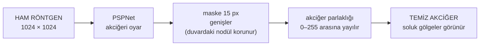
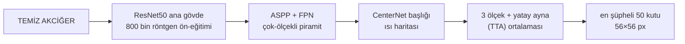
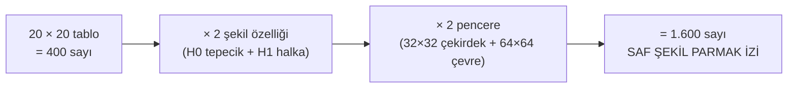
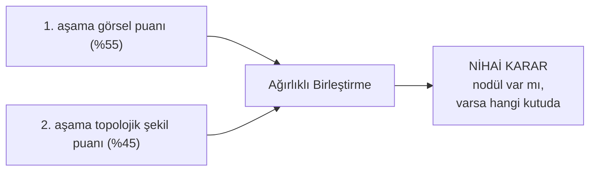
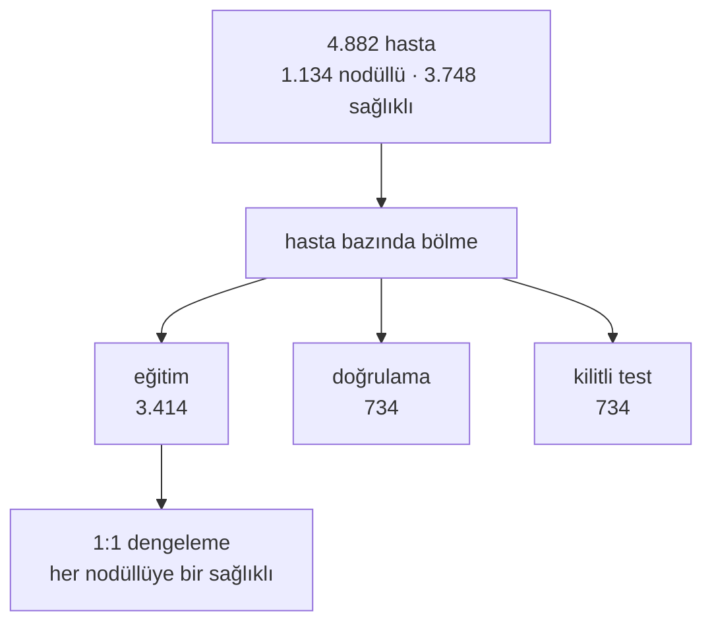
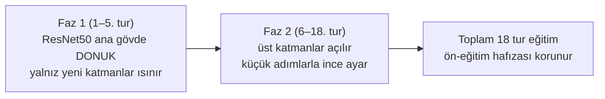
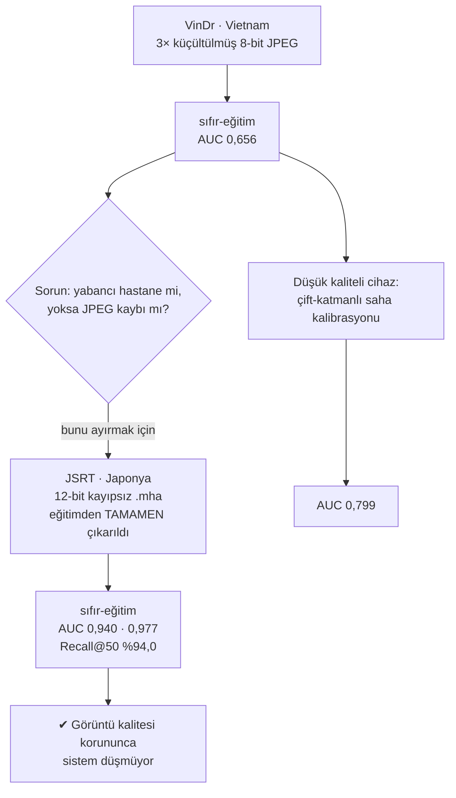

# Göğüs Röntgeninde Nodül Tespiti — İki Aşamalı Bir Dedektif Sistemi

## 1. Çıkış Noktamız: Neyi Çözmeye Çalışıyoruz?

Bir doktor göğüs röntgenine baktığında oldukça zor bir işle karşılaşır: milimetre
çapında, yuvarlak ve soluk bir tümörü (nodülü), göğüs kafesinin karmaşık gölgeleri içinden
ayıklamak. İşin zorluğu şuradan gelir; bu küçük nodüller çoğu zaman kaburgaların kesiştiği,
köprücük kemiğinin geçtiği veya dikey bir kan damarının üstüne bindiği yerlerde saklanır. Göz
"orada parlak bir şey var" der; ama o parlaklık gerçek bir tümör olabileceği gibi, iki kemiğin
üst üste binmiş sıradan gölgesi de olabilir.

Derin öğrenme modelleri röntgeni taramakta çok hızlıdır ama bu konuda sıkça yanılır: modele
"hiçbir gerçek tümörü kaçırma" dediğimizde, röntgende gördüğü her parlak damar kesitini ve
her kaburga kesişimini "nodül olabilir" diye işaretlemeye başlar. Gerçek tümörleri yakalarız
ama karşılığında her gerçek tümörün yanında onlarca **yanlış alarm (yalancı pozitif)** üretilir.

İşte bu projedeki çıkış noktamız tam olarak budur. Sistemi iki ayrı uzmanın işbirliği gibi
kurduk: Önce **1. aşamadaki hızlı tarayıcı model** röntgenin tamamına bakar ve "şu 50 nokta
şüpheli, hiçbirini atlamayalım" diyerek aday kutuları çıkarır. Ardından **2. aşamadaki şekil
uzmanı** devreye girer: işaretlenen her küçük kutunun içine tek tek büyüteçle bakar, o bölgenin
**geometrik şeklini** matematiksel olarak inceler ve "bu yuvarlak bir tümör yumrusu, bu ise
sadece uzun bir damar gölgesi" diyerek yanlış alarmları eler. Bu ikinci uzmanın kullandığı
matematiksel araç **Topolojik Veri Analizi (Kübik Kalıcı Homoloji)** yöntemidir. Bunun nasıl
çalıştığını, sisteme giren bir röntgenin geçtiği dört durak üzerinden adım adım anlatmak isterim.

---

## 2. Bir Röntgenin Sistem İçindeki Yolculuğu

Sisteme 1024×1024 piksellik ham bir röntgen giriyor. Bu görüntü, son karara ulaşana kadar
dört duraktan geçiyor:

**Durak 1 — Sahneyi Temizleme ve Parlaklığı Canlandırma.**

İlk işimiz röntgendeki gereksiz bölgeleri temizlemektir. Omuz kemikleri, omurga ve karın boşluğu
gibi akciğer dışı alanlar modeli yanıltır; bu yüzden TorchXRayVision kütüphanesinin PSPNet adlı
bölütleme modeliyle akciğerleri görüntünün içinden adeta **oyup çıkarıyoruz**. Ancak burada
kritik bir detaya dikkat ettik: akciğerin dış duvarına (plevraya) yapışık tümörler, kesim sınırı
tam duvarın üzerinden geçtiğinde yanlışlıkla dışarıda kalıp silinebilir. Bunu önlemek için
akciğer maskesini duvarın **15 piksel dışına doğru** genişletiyoruz. Ardından parlaklığı
düzenliyoruz: tıbbi röntgenler 12 veya 16 bit derinlikte (binlerce gri tonuyla) saklanır; bunu
doğrudan standart "0–255" aralığına sıkıştırdığımızda soluk tümörler silinip gider. Bunun yerine
akciğer içindeki en karanlık %1 ve en parlak %1'lik uç gürültüleri kesip, kalan gerçek akciğer
dokusu parlaklığını 0–255 arasına yayıyoruz; böylece en soluk nodüller bile net biçimde görünür
hale geliyor.

**Durak 2 — Termal Kamera Gibi Tarama (1. Aşama: Şüpheli Aday Bulucu).**

Temizlenmiş akciğer görüntüsü, şimdi 800 binden fazla gerçek göğüs röntgeniyle önceden eğitilmiş
ana görsel gövdeye (**ResNet50** modeline) girer. Bu ana gövde "röntgen görüntüsünün dilini"
zaten iyi bilir. Onun hemen arkasına eklediğimiz çok-ölçekli özellik piramidi (ASPP + FPN), hem
mercimek kadar küçük hem de ceviz kadar büyük kitleleri aynı anda yakalayabilmek için görüntüye
farklı ölçeklerden bakar. En uçtaki **CenterNet başlığı** ise şüpheli tümör merkezlerini, tıpkı bir
**termal kameranın sıcak noktaları göstermesi gibi** parlak tepecikler olarak işaretler.

Hiçbir tümörü gözden kaçırmamak için röntgene tek bir açıdan bakmakla yetinmiyoruz: görüntüyü
**3 farklı büyüklükte** (0,9×, 1,0×, 1,1×) ve bir de **yatay aynalanmış** haliyle tarayıp
(test-zamanı artırma — TTA) tahminlerin ortalamasını alıyoruz. Sonuçta en parlak 50 sıcak nokta,
merkezlerinin etrafına 56×56 piksellik birer kutu çizilerek seçiliyor. Bu ilk aşama görevini
başarıyla yapıyor: gerçek tümörlerin **%98–99'u bu 50 şüpheli kutunun içine giriyor**. Ancak bu
50 kutunun büyük kısmı hâlâ damar veya kemik gölgesi.

**Durak 3 — Şüpheli Kutulara Topolojik Büyüteç Tutma (2. Aşama: Şekil Analizi).**

Şimdi ikinci uzmanımız devreye giriyor. İlk aşamadan gelen 50 kutunun her birinin merkezinden iç
içe iki küçük pencere kesiyoruz: tümörün tam göbeğini gören **32×32 piksellik iç çekirdek** ve
etrafındaki doku geçişini gören **64×64 piksellik dış çevre**. Her küçük kareyi, piksel
parlaklığının "yükseklik" olduğu 3 boyutlu engebeli bir arazi (tepecikler ve çukurlar) gibi
düşünüyoruz.

GUDHI kütüphanesiyle hesapladığımız **Kübik Kalıcı Homoloji** şunu yapar: Parlaklık eşiğini
0'dan 255'e doğru adım adım yükseltirken, o arazideki **parlak tepeciklerin (bağlı bileşenler — H0)**
ve **kapalı halka/delik şekillerinin (döngüler — H1)** hangi parlaklık seviyesinde ortaya çıkıp
(doğum) hangi seviyede birleşerek kaybolduğunu (ölüm) takip eder.

Bu doğum ve ölüm noktalarını 20×20'lik bir tabloya (**Kalıcılık İmgesi**) yerleştiriyoruz (yatay
eksen = şeklin doğduğu parlaklık, dikey eksen = ne kadar uzun süre korunduğu). Ortaya çıkan
20×20 = 400 sayılık tablo, o kesitin **matematiksel şekil özetidir**: gerçek bir tümör kompakt ve
belirgin bir tepe izi bırakırken, damar ve kaburga gölgeleri dağınık ve çizgisel izler bırakır.
Özellik vektörümüz tam olarak şöyle oluşur:

Böylece her şüpheli kutu için, sadece ham piksellere değil doğrudan **o bölgenin geometrik
şekline** bakan **1.600 sayılık** bir parmak izi elde ederiz.

> 📌 **Neden 1.604 değil 1.600?** Önceki sürümde bu 1.600 sayıya **4 konum sütunu** ekleniyordu
> (kutunun akciğer içindeki x/y konumu, akciğer merkezine uzaklığı, akciğer sınırına uzaklığı).
> Bunları ayrı ayrı ölçtük: nihai skora **ölçülebilir bir katkı sağlamadılar** (fark ±0,001,
> işaretler tutarsız), üstelik aday düzeyinde şekil kanıtını bir miktar **bastırdılar**
> (0,939 → 0,924). "Gereksiz karmaşıklık eklemeyelim" ilkesiyle **çıkardık**; sistem artık
> %100 saf topolojik şekil üzerinde çalışıyor. Bu sadeleştirme resmî ölçütte **eşit** sonuç
> verdi (0,9047 vs 0,9045), tek bedeli en sıkı yanlış-alarm eşiğinde ~2,6 puan duyarlılık oldu —
> bunu aşağıda dürüstçe yazıyorum.

**Durak 4 — İki Uzmanın Ortak Kararı (HGB ve Birleştirme).**

Bu 1.600 boyutlu şekil parmak izini, ağaç tabanlı hızlı bir karar modeline (HistGradientBoosting —
HGB) veriyoruz. HGB modeli, "bu şekil parmak izi gerçek bir tümöre mi yoksa damar/kemik gölgesine
mi ait?" sorusuna bir puan veriyor. Son adımda iki uzmanın görüşünü birleştiriyoruz: **1. aşama
tarayıcı modelin görsel puanı (%55 ağırlık)** ile **2. aşama modelin topolojik şekil puanı (%45
ağırlık)** bir araya gelerek hem nihai tümör kutularını hem de hastanın genel nodül riskini
belirliyor.

---

## 3. Bu Makineyi Sıfırdan Nasıl İnşa Ettik ve Eğittik?

Bu sistemi kurarken ve eğitirken izlediğimiz dört temel mühendislik adımı şunlardır:

**Adım 1 — Sızıntısız Veri Bölünmesi.** Halka açık NODE21 veri setindeki 4.882 hasta (1.134
nodüllü, 3.748 sağlıklı kontrol), **hasta bazında** üçe ayrıldı: 3.414 eğitim, 734 doğrulama ve
734 kilitli test. Burada en katı kuralımız şuydu: bir hastanın röntgeni asla iki farklı kümeye
düşmez; aksi halde model hastayı ezberler ve test sonucu yanıltıcı olur. Eğitim aşamasında ise
nodüllü hasta sayısı sağlıklı olanlardan çok daha az olduğu için, model "herkese sağlıklı de geç"
kolaycılığına kaçmasın diye her nodüllü hastaya bir sağlıklı hasta eşleyerek eğitimi 1:1 oranında
dengeledik.

**Adım 2 — 1. Aşama Tarayıcı Modelin İki Fazlı Eğitimi (Unutmayı Önleme).** 800 bin röntgenden
öğrenilmiş bilgiyi taşıyan hazır ResNet50 ana gövdesi bizim için çok değerlidir. Ancak üstüne
yeni eklediğimiz piramit ve ısı haritası katmanları ilk başta rastgele tahminler yapar; eğer tüm
ağı ilk andan itibaren birlikte eğitirsek, bu rastgele hatalar ana gövdenin 800 bin röntgenlik
hafızasını bozar. Bunu önlemek için eğitimi iki aşamaya böldük: **İlk 5 turda (epoch) ana gövdeyi
tamamen dondurduk** ve sadece yeni eklediğimiz katmanları eğittik. Yeni katmanlar mantıklı
tahminler yapmaya başladıktan sonra, **kalan 13 turda ana gövdenin üst katmanlarını da açarak**
çok küçük adımlarla (düşük öğrenme hızıyla, toplam 18 tur) tüm sistemi birlikte ince ayarladık.

**Adım 3 — 2. Aşama Şekil Modelinin "Zor-Negatiflerle" Eğitimi.** 2. aşamadaki HGB karar modelini
rastgele seçilmiş boş ve kolay akciğer parçalarıyla eğitmek ona hiçbir şey öğretmezdi. Bunun
yerine, eğittiğimiz 1. aşama tarayıcı modeli eğitim hastalarının üzerinde çalıştırdık ve ürettiği
**74.482 şüpheli kutuyu** topladık. Gerçek tümörün üstüne denk gelen kutuları **Pozitif (1)**,
1. aşama modelinin yanılıp tümör sandığı damar ve kaburga kesişimlerini ise **Zor-Negatif (0)**
olarak etiketledik. HGB modelini tam olarak bu zorlu örnekler üzerinde (1 gerçek tümöre karşılık
yaklaşık 49 yanlış alarm düştüğü için pozitif sınıfa otomatik dengeleme ağırlığı vererek) eğittik.
Böylece 2. aşama, 1. aşamanın **gerçekten karıştırdığı** kemik/damar gölgelerini şekillerinden
ayırmayı öğrendi.

**Adım 4 — Aşırı Özgüven Tuzağından Kaçınma.** İki aşamayı birleştirirken çok sık yapılan bir
hata vardır: 1. aşama modelinin kendi eğitim verisi üzerinde verdiği puanları 2. aşama modeline
girdi olarak vermek. Oysa 1. aşama modeli eğitimde gördüğü röntgenleri tanıdığı için orada aşırı
yüksek (şişkin) puanlar verir; 2. aşama da "1. aşama zaten her şeyi biliyor" sanıp kendi topolojik
özelliklerine bakmayı bırakır ve yeni bir test hastası geldiğinde yanılır. Biz bu tuzağı tamamen
kapattık: 2. aşamadaki HGB modeline 1. aşamanın puanını **hiç göstermedik** (sadece 1.600 saf
şekil özelliğiyle eğittik); iki uzmanın puanlarını en sonda doğrulama kümesinde belirlenen sabit
ağırlıklarla (%55 ve %45) birleştirdik.

---

## 4. Deneysel Sonuçlar ve Kanıtlar

| Ölçüt | Sonuç | Ne anlama geliyor |
| :--- | :---: | :--- |
| 1. Aşama aday yakalama (Recall@K) | **%98,3 (K20) → %99,1 (K50)** | 1. aşama tarayıcı model ilk 50 kutuda gerçek nodüllerin neredeyse tamamını yakalıyor; "kaçırmama" görevi tamam |
| Küçük kutuda piksel CNN vs. lokal TDA | **0,646 vs. 0,926 AUC** | Aynı küçük kareyi ham pikselleriyle inceleyen CNN zayıf kalırken (`0,646`), **şeklini** inceleyen TDA çok güçlü ayrım sağlıyor (`0,926`) |
| Kilitli test (734 hasta) — yalnız 1. aşama | **0,945 AUC** (S@0.25 %70,3 · S@0.50 %76,4) | 1. aşama tarayıcı model tek başına da güçlü bir başlangıç sağlıyor |
| Kilitli test — 1.+2. aşama birleşimi (Füzyon) | **0,966 AUC** (S@0.25 %72,1 · S@0.50 %76,4) | 2. aşama topolojik katman, 1. aşamanın kararsız kaldığı yerleri tamamlıyor: hasta AUC **+2,2 puan**, S@0.25'te **+1,7 puan** |
| Harici veri 1 — Düşük kalite JPEG (VinDr-CXR, Vietnam; 400 görüntü) | **0,656 (sıfır-eğitim) → 0,799 AUC** (160 görüntüyle saha kalibrasyonu) | 3× küçültülmüş ve 8-bit JPEG olarak sıkıştırılmış harici veride sıfır-eğitimde başarı düşüyor; ancak az sayıda yerel örnekle iki katman birlikte kalibre edildiğinde **0,80** düzeyine çıkıyor |
| Harici veri 2 — Yüksek kalite tıbbi format (JSRT, Japonya; eğitimden tamamen izole) | **0,940 (Top-1) / 0,977 (Noisy-OR) AUC · %94,0 Recall@50** (sıfır-eğitim) | Dış hastanenin görüntüleri JPEG gibi sıkıştırılmamış, yüksek kaliteli (12-bit `.mha`) olduğunda sistem **hiç kalibrasyon yapmadan (sıfır-eğitimle)** yüksek başarısını koruyor |

Tablodaki bulgularımız üç temel gerçeği ortaya koymaktadır:

1. Küçük şüpheli kutularda ayırt edici bilgi ham piksel dokusunda değil **geometrik şekilde**
   yatmaktadır (`0,646` vs `0,926`).
2. Topolojik katman kilitli test setinde 1. aşama tarayıcı modelin eksik bıraktığı kısmı
   tamamlayarak genel başarıyı `0,945`'ten `0,966`'ya taşımaktadır.
3. Harici testlerdeki sıfır-eğitim farkı (`0,656` vs `0,940–0,977`), modelin başka bir hastaneye
   gittiğinde düşmesinin ana sebebinin "yabancı hastane" değil, **görüntünün 8-bit JPEG ile
   sıkıştırılıp çözünürlüğünün düşürülmesi** olduğunu **kuvvetle göstermektedir**; ancak iki veri
   setinin hasta ve cihaz yapısı da farklı olduğundan, bunun doğrudan kanıtı için aynı hastanenin
   16-bit DICOM arşiviyle tekrar ölçüm gerekir.

---

## 5. Yaptığımız Zorlu Kontroller ve Dürüst Sınırlılıklar

Yalnızca yüksek skor kovalamadık; elde ettiğimiz sonuçlardan emin olmak ve harici veri davranışını
doğru anlamak için sistemi zorlu denetimlerden geçirdik:

**1. Neden Vietnam (VinDr) Verisinde Sıfır-Eğitimde Düşüş Yaşandı ve Bunu Test Etmek İçin Neden
JSRT'yi İzole Ettik?**
Elimizdeki harici Vietnam (VinDr-CXR) veri kümesi, açık kaynakta paylaşılan **3 kat küçültülmüş ve
8-bit JPEG olarak sıkıştırılmış** bir kopyaydı (orijinal 16-bit kayıpsız DICOM arşivi
**onlarca/yüzlerce GB** büyüklüğünde olduğu ve kısıtlı/onaylı erişim gerektirdiği için yalnızca
400 dosyalık yüksek kaliteli versiyonuna açık API'ler üzerinden erişemedik). JPEG sıkıştırması
görüntüyü 8×8 piksellik bloklara bölerek ince doku geçişlerini bozduğu için, 2. aşamadaki topolojik
hesaplamamız (TDA) bu yapay blok kenarlarından olumsuz etkilendi ve sıfır-eğitim başarısı
`0,656 AUC` seviyesinde kaldı.

Bunun üzerine kendimize şu soruyu sorduk: *"Eğer hiç görmediğimiz yabancı bir hastanenin röntgenleri
bozuk JPEG değil de, eğitimdeki gibi kayıpsız 12-bit `.mha` kalitesinde olsaydı ne olurdu?"*
Bunu ölçmek için NODE21 içindeki 4 alt kaynaktan biri olan **Japonya (JSRT, 149 hasta)** veri
setini eğitimden **tamamen çıkardık** (zaten 1. aşamadaki hazır ResNet50 gövdesi de ön-eğitiminde
JSRT'yi hiç görmemişti) ve ana mimariye hiç dokunmadan izole bir modeli sıfırdan eğittik. Sonuç tam
düşündüğümüz gibi çıktı: Görüntü kalitesi kayıpsız 12-bit `.mha` olduğunda, model hayatında hiç
görmediği Japonya hastanesinde **hiç kalibrasyon yapmadan (sıfır-eğitimle)** ilk 50 kutuda
nodüllerin **%94,0'ını** yakaladı ve **0,940 (Top-1) / 0,977 (Noisy-OR) hasta AUC** değerine
ulaştı. Daha da önemlisi, yalnız 2. aşama Lokal TDA puanına bakıldığında JSRT'yi hiç görmeyen model
(`0,958 AUC`) ile JSRT'yi gören ana model (`0,957 AUC`) **birebir aynı başarıyı** verdi; yani
topolojik şekil özetimiz yüksek kaliteli röntgenlerde hastaneden hastaneye kayıpsız
taşınmaktadır.

**2. Düşük Kaliteli Hastane Verisinde Saha Kalibrasyonu (Çift-katmanlı uyarlama).**
Peki görüntü kalitesinin düşük olduğu (8-bit JPEG Vietnam verisi gibi) bir hastaneye sistem
kurulduğunda ne yapılmalı? Bunu test ettiğimizde; sadece 2. aşamayı yerel örneklerle kalibre
etmenin skoru `0,70`'e, sadece 1. aşama başlığını ince ayarlamanın ise `0,73`'e taşıyabildiğini
gördük. Ancak **her iki aşamayı birlikte** kalibre ettiğimizde güçlü bir tamamlayıcılıkla
**`0,799 AUC`** değerine ulaştık. Bu da sistemin düşük kaliteli cihazlara sahip bir hastanede bile
az sayıda yerel örnekle hızla toparlanabildiğini gösteriyor.

**3. Ön-eğitim veri örtüşmesi skoru şişiriyor mu?**
NODE21 veri seti açık kaynaklı röntgenlerden derlendiği için, 1. aşamada kullandığımız hazır
ResNet50 gövdesi pozitif vakaların bir kısmını (NIH ve PadChest) ön-eğitim sırasında (kutu etiketi
olmadan) görmüştü. "Acaba başarımız bu yüzden mi yüksek?" şüphesiyle modeli hiç röntgen görmemiş bir
ImageNet gövdesiyle kıyasladık. Sonuç tam tersini gösterdi: Hazır gövdenin asıl büyük faydası, daha
önce gördüğü kaynaklarda değil, **hayatında hiç görmediği** kaynaklarda (**+0,325 AUC**
sağlamlaştırma etkisiyle) ortaya çıktı.

**4. Dürüst sınırlılıklar.**
Çalışmamızın sınırları da nettir: Topolojik katman hasta düzeyindeki ayrımı ve orta yanlış-alarm
noktalarını (`S@0.25` ve `S@0.50`) belirgin biçimde güçlendirirken, en katı yanlış-alarm eşiğinde
(`S@0.125`) çok küçük bir duyarlılık tavizi verebiliyor. Kutu boyutu konusunda her tümöre kendi
büyüklüğünde dinamik kutu çizen bir başlık da eğittik; doğrulama setinde sabit 56×56 kutuyu geçse de
(`0,9185` vs `0,9131`) kilitli test setinde S@0.25 kutu duyarlılığını değiştirmediği için (%70,3) daha
sade olan sabit kutuyu varsayılan olarak koruduk.

Bir de **temsili sadeleştirdik**: 1.600 topolojik sayıya eklediğimiz 4 konum sütununun nihai
skora katkısı ölçülemediği için onları çıkardık. Bu karar **resmî ölçütte eşit** sonuç verdi
(0,9047 vs 0,9045) — ama **bedava değil**: en sıkı yanlış-alarm eşiğinde (S@0,5) duyarlılık
0,7904'ten 0,7642'ye, yani **2,6 puan** düştü; buna karşılık S@0,25'te 0,87 puan kazandık.
Yani sadeleştirmenin bedeli **eşiğe bağlı**: gevşek ayarda kazanıyor, sıkı ayarda kaybediyor.
Bunu gizlemeden yazıyorum; klinik kullanımda "çok az yanlış alarm" rejimi hedeflenirse o 2,6
puan önemli olabilir.

---

## 6. Sonuç ve Danışmak İstediklerim

Bu çalışmada, "derin öğrenme ile hızlı tarama" ve "topolojik veri analizi ile şekil inceleme"
fikirlerini birleştirerek göğüs röntgeninde nodül bulan uçtan uca bir sistem kurmayı; bu sistemi
sızıntı kontrolleriyle denetlemeyi ve sınırlarını dürüstçe ölçmeyi öğrendim.

Bir lisans öğrencisi olarak bu noktadan sonra nasıl bir yol izlemem gerektiğini — bu çalışmanın bir
akademik yayına, bildiriye ya da daha kapsamlı bir projeye dönüşüp dönüşemeyeceğini — sizden
öğrenmek isterim. Özellikle hangi yöne ağırlık vermem gerektiği, hangi eksikliğin en kritik olduğu
ve bu çalışmanın akademik olarak nasıl değerlendirilebileceği konusundaki yönlendirmeniz benim için
çok kıymetli olacaktır.
