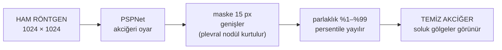
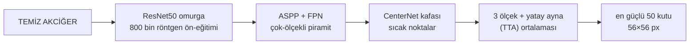
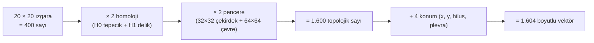
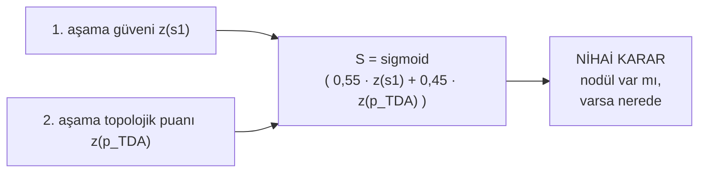
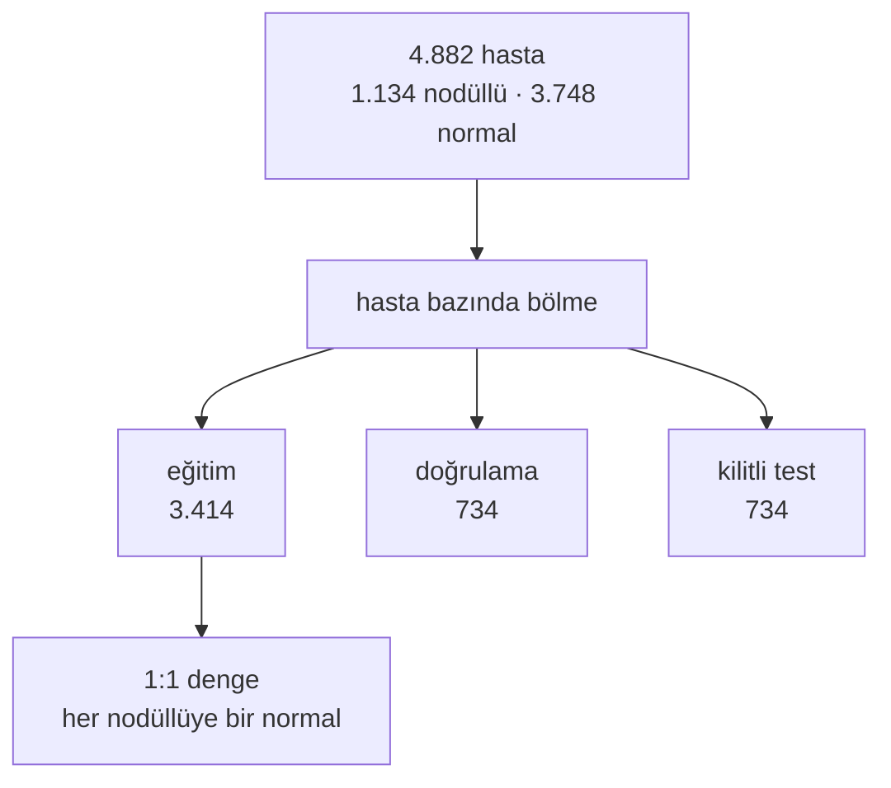
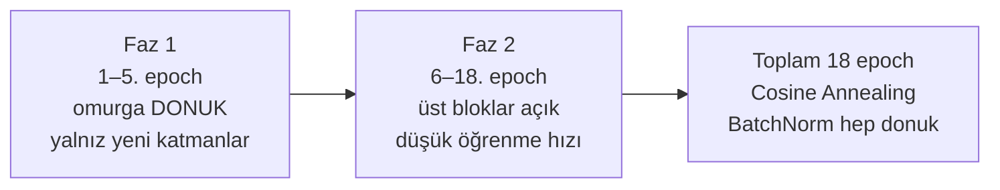

# Göğüs Röntgeninde Nodül Tespiti — İki Aşamalı Bir Dedektif Sistemi

## 1. Çıkış Noktamız: Neyi Çözmeye Çalışıyoruz?

Bir radyolog göğüs röntgenine baktığında aslında çok zor bir oyun oynar: milimetre
çapında, yuvarlak ve soluk bir lezyonu (nodülü), koca bir göğüs kafesinin gölgesi içinden
ayıklamak. İşin zorluğu şu ki bu küçük lezyonlar çoğu zaman tam da kaburgaların kesiştiği,
köprücük kemiğinin veya dikey bir damarın üstüne bindirdiği yerde durur. Göz, "orada bir şey
var" der; ama o "şey" gerçek bir tümör olabileceği gibi, iki kemiğin üst üste binmiş
gölgesinden ibaret de olabilir.

Derin öğrenme tam da burada inanılmaz hızlıdır, ama saf: modelimize yüz binlerce röntgen
gösterdik ki "şüpheli görünen bölgeyi" kaçırmasın; karşılığında bize **çok fazla** şüpheli bölge
işaretlemeye başladı — bir damar kesitini, bir kaburga köşesini, hatta iki kemiğin kesiştiği
sıradan bir noktayı "nodül" sandı. Yüksek duyarlılık sağladık ama bedeli, her gerçek nodülün
yanında düzinelerce **yalancı pozitif**.

İşte çıkış noktamız bu. Sistemi iki uzmanın elinden çıkmış gibi kurduk: önce **hızlı ama saf bir
tarayıcı** görüntünün tamamına bakar ve "şu bölgeler şüpheli, hepsini işaretleyelim, hiçbirini
atlamayalım" der. Sonra **ikinci, sabırlı bir uzman** girer: işaretlenen her kutunun içine ayrı ayrı
eğilir, o karenin **şeklini** matematiksel olarak inceler ve "bu yuvarlak bir tümör, bu ise damar
gölgesi" diye hüküm verir. O ikinci uzmanın aleti **Topolojik Veri Analizi** — özellikle Kübik
Kalıcı Homoloji. Bunun ne olduğunu, bir röntgenin sistemimizde geçtiği dört durak üzerinden
göstereceğim.

---

## 2. Bir Röntgenin Sistem İçindeki Yolculuğu

Sisteme 1024×1024 piksellik ham bir röntgen giriyor. Bu görüntü, nihai karara ulaşana kadar
dört duraktan geçiyor; her durağı aşağıda kendi şemasıyla birlikte anlatıyorum.

**Durak 1 — Sahneyi Temizleme ve Parlaklığı Canlandırma.**

İlk işimiz, görüntüdeki gürültüyü atmak. Omuz, omurga, karın çevresi gibi bizimle ilgisi
olmayan bölgeler yalnızca kafa karıştırır; bu yüzden TorchXRayVision'ın PSPNet adlı segmentasyon
ağıyla akciğeri görüntünün içinden adeta **oyup çıkarıyoruz**. Ama burada incelikli bir tehlikenin
farkındaydık: akciğer duvarına yapışmış (plevral) nodüller, makas tam duvarın üzerinden geçtiğinde
yanlışlıkla kesilip atılabilir. Bu yüzden maskeyi duvarın **15 piksel dışına** genişletiyoruz —
küçük bir pay, ama kenardaki tümörü kurtarır. Ardından parlaklığı canlandırıyoruz: tıbbi röntgenler
12 veya 16 bit derinlikte saklanır; bu derinlikteki soluk nodüller, ham hâliyle "0–255" arasına
sıkıştırıldığında yok olup gidebilir. Onun yerine parlaklığı **yalnızca akciğer dokusunun %1–%99
persentil aralığına** yayarak her soluk gölgeyi olabildiğince görünür kılıyoruz.

**Durak 2 — Termal Kamera Gibi Tarama (1. Aşama).**

Temizlenmiş akciğer, şimdi 800 binden fazla gerçek göğüs röntgeniyle önceden eğitilmiş bir
**ResNet50** omurgasına giriyor. Bu omurga "röntgenin genel dilini" zaten biliyor; biz onun üstüne
kendi dedektörümüzü koyuyoruz. Arkasındaki çok-ölçekli piramit (ASPP + FPN), hem bezelye kadar
küçük hem ceviz kadar büyük kitleleri aynı anda görebilmek için görüntüye farklı çözünürlüklerden
bakar; en uçtaki **CenterNet kafası** da tümör merkezlerini, tıpkı bir **termal kameranın sıcak
noktaları gibi** parlak birer "sıcak nokta" olarak ışıtır.

İşin sırrı güven veren tek bir geçişe yetinmemek: aynı görüntüyü **3 farklı ölçekte** (0,9×, 1,0×,
1,1×) ve bir de **yatay aynasından** tarayıp (bu tekniğe test-zamanı artırma, kısaca TTA deriz)
her tahmini ortalamalıyoruz — bir kamerayla çekip, emin olmak için bir de aynadan bakıp iki görüntüyü
üst üste koymak gibi. Sonuç: en güçlü 50 sıcak nokta, 56×56 piksellik kutu olarak işaretleniyor.
Bu 50 kutunun güzelliği şu: gerçek tümörlerin **%98–99'u bu kutuların içine giriyor**. Yani 1. aşama
görevini yaptı — hiçbir şeyi atlamadı; ama bu 50 kutunun çoğu hâlâ damar gölgesi.

**Durak 3 — Şüpheli Kutulara Topolojik Büyüteç Tutma (2. Aşama).**

Şimdi sabırlı uzman devreye giriyor. 50 kutunun her birinin merkezinden iç içe iki pencere
kesiyoruz: **32×32 piksellik bir iç çekirdek** (tümörün kendisi, eğer varsa) ve **64×64 piksellik
bir dış çevre** (onun etrafındaki bağlam). Her kareyi, parlaklığın **yükseklik** olduğu engebeli bir
arazi gibi ele alıp GUDHI kütüphanesiyle iki şey ölçüyoruz: o arazideki **tepecikler** (bağlı
bölgeler, H0) ve **delik/döngüler** (kapalı yapılar, H1), her birinin *hangi parlaklıkta doğup*
*hangi parlaklıkta kaybolduğu*yla birlikte.

Bu noktaları 20×20'lik bir ızgaraya düşürüyoruz (x ekseni = doğduğu parlaklık, y ekseni = ne kadar
uzun yaşadığı) ve her hücrede ne kadar "güç" biriktiğini topluyoruz. Ortaya çıkan 20×20 = 400 sayılık
tablo, kesitin **şekil haritası**: tümör tek, dar ve yüksek bir tepe üretir; damar ise geniş, dağınık
ve dallı bir "sırt çizgisi". Vektörün tam hesabı şöyle:

Bu vektör iki ölçekte, iki homoloji boyutunda kesitin parlaklık şeklini ve konumunu özetler; yani
her kutu için, retina gibi piksellere değil **şekle** bakan bir imzadır.

**Durak 4 — İki Uzmanın Ortak Kararı (HGB ve Birleştirme).**

Bu 1.604 boyutlu parmak izini, hızlı ve yorumlanabilir bir karar modeline (HistGradientBoosting,
kısaca HGB) veriyoruz. HGB, "bu parmak izi gerçek tümöre mi yoksa damara mı ait?" sorusunu puanlıyor.
Sonra iki uzmanın görüşünü birleştiriyoruz: 1. aşamanın **görsel güveni** (ağırlığı 0,55) ile
2. aşamanın **topolojik puanı** (ağırlığı 0,45) ağırlıklı bir toplamda buluşuyor. Böylece hem nihai
kutu hem de "bu hastada nodül var mı?" sorusunun cevabı ortaya çıkıyor.

---

## 3. Bu Makineyi Sıfırdan Nasıl İnşa Ettik ve Eğittik?

Hocanın doğal sorusu: "Peki bunu teknik olarak nasıl kurdunuz?" Dört adımda özetleyeyim.

**Adım 1 — Sızıntısız Veri Bölünmesi.** Elinizdeki 4.882 NODE21 hastası (1.134 nodüllü, 3.748
normal), **hasta bazında** üçe ayrıldı: 3.414 eğitim, 734 doğrulama, 734 kilitli test. Önemli olan
şu: bir hastanın görüntüsü asla iki farklı kümeye düşmez — aksi hâlde model kendi test verisini
"görüp ezberleyerek" yanıltıcı bir başarı raporlarız. Eğitimde de dengesizliği önledik: nodüllü
sayısı normalden çok az olduğu için, her nodüllü hastaya bir normal hasta eşleyerek eğitimi 1:1
dengeledik. Yoksa model "her şeye sağlam de" diyen tembel bir öğrenci olurdu.

**Adım 2 — 1. Aşamanın İki Fazlı Eğitimi (Unutmayı Önleme).** 800 bin röntgenlik tıbbi bilgiyi
içinde taşıyan hazır ResNet50 omurgası, bizim için altın değerinde. Ama yeni eklenen katmanların
ilk adımları rastgele ağırlıklarla doludur; böyle gürültülü gradyanların omurgaya akmasına izin
verirsek o 800 bin röntgenlik "hafızayı" bozarız. Bu yüzden eğitimi iki faza böldük: önce **5 epoch
boyunca omurga tamamen donuk**, yalnızca yeni eklediğimiz katmanlar ısınıyor; sonra **13 epoch
boyunca omurganın yalnızca üst bloklarını çok düşük öğrenme hızıyla** (Cosine Annealing ile
sönümlenerek) açıyoruz. Toplam 18 epoch; BatchNorm istatistikleri baştan sona donuk tutuluyor ki 800
bin röntgenden gelen normalizasyon bilgisi hiç bozulmasın. Bu kademeli yaklaşıma "diferansiyel ince
ayar" diyoruz.

**Adım 3 — 2. Aşamanın Zor-Negatiflerle Eğitimi.** 2. aşamayı rastgele "kolay" akciğer parçalarıyla
eğitmek ona hiçbir şey öğretmezdi. Bunun yerine, 1. aşamayı eğitim hastalarının üzerinde çalıştırdık
ve **74.482 şüpheli kutu** topladık. Gerçek nodülün tam üstüne oturan kutular **Pozitif**, dedektörün
yanıldığı — damarı ya da kaburga kesişimini nodül sandığı — kutular ise **Zor-Negatif** oldu. Modeli
tam olarak bu zor örneklerle, `class_weight="balanced"` korumasıyla eğittik (bir nodüle karşılık yaklaşık
50 zor-negatif var; nadir pozitif sınıfa bu yüzden otomatik ağırlık verdik). Böylece 2. aşama,
dedektörün **gerçekten karıştırdığı** şeyleri ayırt etmeyi öğrendi.

**Adım 4 — Aşırı Özgüven (Stacking) Tuzağından Kaçınma.** Birleştirmenin naif yolu şu olurdu:
2. aşamaya, 1. aşamanın skorunu da bir özellik olarak verirsin. Ama bu tehlikeli bir tuzak: 1. aşamanın
skoru **kendi eğitim verisinde** şişmiştir (model ezberlediği örneklerde aşırı özgüvenlidir); 2. aşama
bu şişkin puanı "gerçek" sanıp ona kilitlenir, gerçek hayatta ise çöker. Biz bu tuzağa düşmedik:
2. aşamaya 1. aşamanın eğitim-skorunu **hiç göstermedik** (kod seviyesinde `stage1_score_included=False`
olarak mühürlendi) ve birleştirmeyi **doğrulama kümesinde bir kez belirlenip dondurulan** sabit bir
ağırlıkla (w = 0,55) yaptık. Bu ağırlık hiçbir veri kümesinde yeniden öğrenilmedi.

---

## 4. Deneysel Sonuçlar ve Kanıtlar

| Ölçüt | Sonuç | Ne anlama geliyor |
| :--- | :---: | :--- |
| Aday yakalama (Recall@K) | **%98,3 (K20) → %99,1 (K50)** | 1. aşama ilk 50 kutuda gerçek nodüllerin neredeyse tamamını yakalıyor; "kaçırmama" görevi tamam |
| Küçük kırpıntıda piksel CNN vs. lokal TDA | **0,646 vs. 0,926** | Aynı küçük kareyi pikselleriyle inceleyen CNN ≈şansın biraz üstü; **şeklini** inceleyen TDA çok daha ayırt edici |
| Kilitli test — yalnız 1. aşama | **0,945 AUC · 0,884 skor** | Dedektör tek başına güçlü bir tarayıcı |
| Kilitli test — 1.+2. aşama füzyon | **0,969 AUC · 0,905 skor** (S@0.25 %71,2 · S@0.50 %79,0) | Topolojik katman, dedektörün emin olmadığı kısmı tamamlıyor: AUC +0,024, resmî skor +0,021 |
| Harici veri (VinDr-CXR, Vietnam; sıfır eğitim) | **0,656 → 0,799** (160 etiketli görüntüyle saha kalibrasyonu) | Farklı bir ülkeye/hastaneye taşınınca önce düşüyor, ama az sayıda sahaya özgü örnekle belirgin biçimde toparlanıyor |

Tablodaki en önemli iki satır şunlar: küçük kırpıntıda ayırt edici bilginin piksellerde değil
**şekilde** olduğu (0,646 vs 0,926), ve topolojik katmanın kilitli testte dedektörün zayıf kaldığı
yeri tamamladığı (AUC 0,945 → 0,969).

---

## 5. Yaptığımız Zorlu Kontroller ve Dürüst Sınırlılıklar

Sadece yüksek sayı kovalamadık; sonuçlara inanmadan önce kendimize en zor soruları sorduk.

**Ön-eğitim örtüşmesi bir hile mi?** Kullandığımız hazır omurga, verilerimizin kaynaklarının bir
kısmını önceden görmüştü; "belki de skor bu yüzden şişiyor" şüphesiyle bir etkileşim testi kurduk.
Sonuç şaşırtıcıydı: omurganın gerçek avantajı, tam da **hiç görmediği** kaynaklarda (JSRT ve OpenI)
+0,325 AUC'luk bir sağlamlaştırma olarak ortaya çıktı. Yani kazanç ezberden değil, genel göğüs
röntgeni bilgisinden geliyor — ve bunu makalemizde açıkça beyan edeceğiz.

**Saha (site) kalibrasyonunun sinerjisi.** Vietnam verisinde, tek başına 2. aşamayı kalibre etmek
0,70–0,73'e kadar taşıyor; tek başına 1. aşamanın kafasını ince ayarlamak da benzeri bir seviyede.
Ama **her iki katmanı birlikte** kalibre ettiğimizde 0,80'e ulaşıyoruz — iki katman birbirinin
zayıf noktasını kapatıyor. Bu, sistemin yeni bir hastaneye "az sayıda yerel örnekle" taşınabileceğinin
umut verici bir işareti.

**Dağıtım.** Sistem araştırma kodundan çıkıp gerçek bir araca dönüşsün diye, resmî Grand-Challenge
standardında, internet bağlantısı olmadan çalışan **çevrimdışı bir Docker paketi** hazırladık.
Girdi olarak üç boyutlu taranmış bir göğsü alıp standart biçimde nodül kutuları üretiyor.

**Samimi sınırlar.** Her şey yolunda değil ve bunların hepsini biliyoruz: en sıkı yanlış-alarm
eşiğinde (FROC) küçük bir ödünleşim var — topoloji hasta düzeyindeki ayrımı güçlendirirken,
milimetrik eşiklerde bir parça duyarlılık verebiliyor. Kutu boyutu konusunda dinamik (öğrenilmiş)
ile sabit 56×56 seçeneğini kıyasladık; dinamik kutu doğrulama setinde parlak göründü ama kilitli
testte resmî skoru değiştirmedi, bu yüzden muhafazakâr sabit kutuyu koruduk. Ve en önemlisi: farklı
bir cihaza **kalibrasyonsuz** geçişte sistem belirgin biçimde zayıflıyor — bu, "tek merkezde güçlü,
çok merkezde emin değiliz" dürüstlüğüyle sunulması gereken bir sınır.

---

## 6. Sonuç ve Danışmak İstediklerim

Bu çalışmada, "derin öğrenme + topolojik veri analizi" gibi iki farklı dünyayı, göğüs röntgeninde
nodül bulmaya yarayan çalışan bir sisteme dönüştürmeyi; onu sabırla, sızıntı kontrolleriyle ve
kendimize sorduğumuz zor sorularla eğitmeyi ve sonunda sınırlarını dürüstçe çizmeyi öğrendim.

Bir lisans öğrencisi olarak bu noktadan sonra yolun ne olacağını — bu çalışmanın bir yayına, bildiriye
ya da daha büyük bir projeye dönüşüp dönüşemeyeceğini — sizden öğrenmek isterim. Özellikle hangi yöne
ağırlık vermem gerektiği, hangi eksikliğin en kritik olduğu ve bu ölçekte bir çalışmanın akademik
olarak nerede konumlandırılabileceği konusundaki yönlendirmeniz benim için çok değerli.
