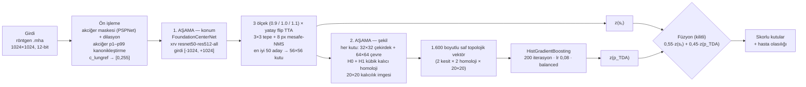

# NODE21 — İki Aşamalı Nodül Tespiti: Topolojik Şekil Analizi + Derin Öğrenme

Göğüs röntgenlerinde (CXR) nodül adaylarını **bulan** ve bu adayları **şekil analiziyle** yeniden
sıralayıp yanlış alarmları eleyen iki aşamalı bir tespit sistemi.

* **1. aşama — konum:** CXR vakıf omurgalı bir CenterNet dedektörü her röntgende en olası 50
  şüpheli noktayı üretir ve 56×56 sabit kutu çizer.
* **2. aşama — şekil:** Her kutunun içinden `32×32` ve `64×64` yamalar kırpılır, **kübik kalıcı
  homoloji (cubical persistent homology)** ile topolojik bir vektör çıkarılır ve bu vektör
  gradient-boosting bir sınıflandırıcıyla "gerçek nodül / yanlış alarm" olarak puanlanır.
* **Füzyon:** İki aşamanın puanı sabit ağırlıklarla birleştirilir:
  `S = σ(0.55 · z(s₁) + 0.45 · z(p_TDA))`.

Sistemin ayırt edici yanı, 2. aşamada ham piksel yerine **topolojik şekil özeti** kullanmasıdır:
aynı küçük kareyi ham pikselleriyle inceleyen bir CNN `0,652` AUC'de kalırken, şeklini inceleyen
TDA aynı kutularda `0,926` AUC'ye ulaşır.

---

## Nihai mimari



**Tasarım kuralları (sabit ve denetlenmiş):**

| Kural | Ne demek |
| :--- | :--- |
| **Tuzak B** | 1. aşama skoru `s₁` **hiçbir zaman** 2. aşama özellik matrisine sütun olarak girmez (`stage1_score_included = False`); yalnız son füzyonda kullanılır. |
| **Saf topolojik temsil** | 2. aşama girdisi %100 TDA'dır: 1.600 boyut, konum/yarıçap/yoğunluk sütunu yok. |
| **Dondurulmuş normalizasyon** | Füzyonun z-referansı (ortalama/sapma) doğrulama kümesinde bir kez dondurulur; testte yeniden hesaplanmaz. |
| **Sabit kutu** | 56×56; yarıçap kafası resmî IoU > 0,20 eşleşmesinde kazanç sağlamadığı için kullanılmaz. |
| **Tek eşik kuralı** | Resmî metrik: IoU > 0,20, aynı hastada aynı GT'ye ikinci isabet ne TP ne FP sayılır. |

---

## Nihai sonuçlar

**Kilitli test — 734 hasta / 229 lezyon** (56×56 kutu, resmî IoU > 0,20 eşleşmesi):

| Ölçüt | Yalnız 1. aşama | **1. + 2. aşama (füzyon)** |
| :--- | ---: | ---: |
| Hasta AUC (top-1) | 0,9446 | **0,9661** |
| `rank_metric` (0,75·AUC + 0,25·S@0,25) | 0,8842 | **0,9047** |
| S@0,125 (0,125 yanlış alarm/röntgen bütçesinde duyarlılık) | — | 0,6070 |
| S@0,25 | %70,3 | **%72,1** |
| S@0,50 | %76,4 | %76,4 |

**Doğrulama — 734 hasta / 231 lezyon:** füzyon AUC **0,9836**, `rank_metric` **0,9304**,
S@0,25 **%77,1**, S@0,50 **%79,7**. 1. aşama lokalizasyonu: **Recall@K20 0,9827 · K50 0,9913**
(FROC@0,5 yanlış alarm/röntgen 0,831).

**Dış doğrulama — hiç görülmemiş hastaneler:**

| Kohort | Sıfır-eğitim | Az sayıda yerel etiketle |
| :--- | ---: | ---: |
| **JSRT** (Japonya, 149 nodüllü + 93 sağlıklı = 242, 12-bit `.mha`) | ilk 10 kutuda **%86,6** · ilk 50'de **%95,3** · AUC **0,9197** (top-1) / **0,9652** (noisy-OR) | 160 etiketli görüntüyle AUC **0,9662**, S@0,50 **%66,4** |
| **VinDr-CXR** (Vietnam, 400 görüntü, 8-bit JPEG) | AUC **0,6376** | 160 görüntüyle **0,7935** |

> Görüntü kalitesi düşük (8-bit JPEG) sitede sıfır-eğitim zayıf ama kalibrasyon kazancı büyük;
> kayıpsız (12-bit) sitede sıfır-eğitim zaten güçlü ve kalibrasyon onu kurum içi düzeye taşıyor.

---

## Kurulum

```powershell
python -m venv venv
venv\Scripts\pip install -r requirements.txt      # torch, torchxrayvision, gudhi, scikit-learn, SimpleITK, scipy
```

**Beklenen veri düzeni** (NODE21 halka açık eğitim seti):

| Yol | İçerik |
| :--- | :--- |
| `dataset_node21/cxr_images/proccessed_data/images/{pid}.mha` | 1024×1024 uint16 röntgenler (4.882 hasta) |
| `data/processed/zones/patients/{pid}/mask_5zones.mha` | akciğer/zon maskeleri (PSPNet çıktısı) |
| `data/processed/splits_v2/patient_splits.csv` | hasta düzeyi train/val/test bölünmesi (3.414 / 734 / 734) |
| `data/processed/features_v5_1/lung_p1p99.json` | hasta başına akciğer p1–p99 yoğunluk sınırları |

Model ağırlıkları depoda **tutulmaz** (`artifacts/v6_two_stage/checkpoints/` sürüm kontrolü
dışındadır); aşağıdaki eğitim adımlarıyla üretilir veya size ayrıca sağlanır.

---

## Kullanım

### A) Bilimsel hat (raporlanan sayıları üreten model)

**1) 1. aşama dedektörünü eğit** (18 epoch, iki fazlı: 5 donuk + 13 diferansiyel ince ayar):

```powershell
python pipelines/v6_two_stage/v6_6_train_foundation.py
# → artifacts/v6_two_stage/checkpoints/M5_foundation.pt
```

**2) 2. aşama topolojik paketini üret** (önce aday + PI önbelleği, sonra 1.600 boyutlu HGB ve
doğrulama kümesinde dondurulan z-referansı):

```powershell
python pipelines/v6_two_stage/v6_9l_spatial_ablation.py   # adaylar + PI önbelleği (1.604 sütun)
python pipelines/v6_two_stage/v6_9m_pure1600_seal.py      # ilk 1.600 sütun → HGB paketi + z-ref
# → artifacts/v6_two_stage/checkpoints/stage2_foundation_tda_hgb_pure1600.joblib
```

**Çıktılar:** `artifacts/v6_two_stage/checkpoints/stage2_foundation_tda_hgb_pure1600.joblib`
(2. aşama paketi) ve
`artifacts/v6_two_stage/v6_9m_pure1600_seal.json` (kilitli test: 734 hasta / 229 lezyon,
resmî IoU > 0,20; TDA-tek ve füzyon metrikleri yan yana).

### B) Dağıtım hattı (tek görüntü çıkarımı ve konteyner)

[`v6_7_submission_infer.py`](pipelines/v6_two_stage/v6_7_submission_infer.py) **dondurulmuş sözleşmeyi** (`artifacts/v6_two_stage/submission_config.json`)
okur ve **%100 veriyle** eğitilmiş paketi kullanır; bu paket önce üretilmelidir:

```powershell
python pipelines/v6_two_stage/v6_7_train_fulldata.py        # 4.882 hastanın tamamıyla 1. aşama
python pipelines/v6_two_stage/v6_7_build_fulldata_stage2.py # 2. aşama + z-ref
python pipelines/v6_two_stage/v6_7_freeze_config.py         # sözleşmeyi (sha256) dondur
# → artifacts/v6_two_stage/submission_fulldata/…

python pipelines/v6_two_stage/v6_7_submission_infer.py --image <rontgen.mha>
python pipelines/v6_two_stage/v6_7_submission_infer.py --smoke        # hızlı öz-test
```

**Grand-Challenge konteyneri:** `submission_docker/` (çevrimdışı `--network=none` altında test
edilmiş, non-root). Girdi/çıktı sözleşmesi ve komutlar:
[`submission_docker/README.md`](submission_docker/README.md).

---

## Depo yapısı

```
pipelines/v6_two_stage/     iki aşamalı hattın tamamı (dedektör, TDA, paket, çıkarım, denetim)
src/node21_tda/             TDA özellik çıkarıcı, segmenter, veri yardımcıları
artifacts/v6_two_stage/     ölçüm kayıtları (JSON) · checkpoint ve önbellekler sürüm dışı
submission_docker/          Grand-Challenge konteyneri (Dockerfile, process.py, smoke test)
data/, dataset_node21/      veri (sürüm dışı)
```

---

## Sınırlar ve dürüst beyan

1. **Ön-eğitim örtüşmesi beyan edilir.** NODE21 açık kaynaklardan derlenmiştir ve omurga (xrv
   `resnet50-res512-all`) bu korpusların bir kısmını **kutusuz** görmüştür: pozitiflerin **%82,9'u**
   omurganın gördüğü kaynaklardandır. Resmî metrik **kutu** tabanlı olduğu için kutu ezberine kapalıdır
   ve temiz omurgayla yapılan kontrol ölçümü şişme göstermemiştir.
2. **Kutu boyu tavanı.** Sabit 56×56 kutu ile test lezyonlarının **%1,7'si** (4/229) hiçbir zaman
   IoU > 0,20 sağlayamaz (doğrulamada %4,3).
3. **Test kümesi yeniden kullanılmıştır.** Geliştirme sırasında birkaç kez değerlendirildiği için
   "dokunulmamış mühür" değil, **yeniden kullanılan doğrulama kümesi** olarak okunmalıdır.
4. **Füzyon ağırlığı öğrenilmemiştir.** `0,55 / 0,45` doğrulama kümesinde bir kez seçilip
   dondurulmuştur; testte ya da harici veride yeniden uyarlanmaz.
5. **Konteyner 1.604 boyutlu 2. aşamayı kullanır.** Tam-veri paketi 4 uzamsal sütunla (1.600 + 4)
   eğitilmiştir: hasta AUC 0,9687 · `rank_metric` 0,9045 · S@0,50 %79,0 (bilimsel paket: 0,9661 /
   0,9047 / %76,4). Aradaki fark `submission_docker/README.md`'de açıkça yazılıdır.
6. **Harici kalibrasyon yerel etiket ister.** JSRT/VinDr kalibrasyon satırları "hedef merkezden
   N etiketli görüntü temin edilirse" senaryosudur; sıfır-eğitim iddiası değildir.

---

## Teknik ayrıntı ve geliştirici notları

* Ayrıntılı yöntem: [`TEKNIK_YONTEM.md`](TEKNIK_YONTEM.md)
* Ölçüm günlüğü: [`experiments.md`](experiments.md) · ablasyon tabloları: [`ablation_matrix.md`](ablation_matrix.md)
* Sızıntı/izolasyon denetimi: [`LEAK_AUDIT.md`](LEAK_AUDIT.md)
* Depo içi gezinme, belge dizini ve sürüm geçmişi: [`README_DEV.md`](README_DEV.md)
