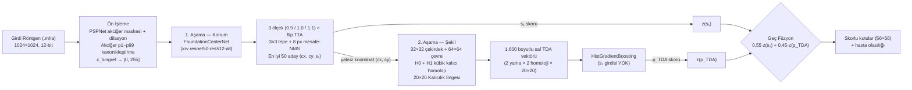

# NODE21 — İki Aşamalı Akciğer Nodülü Tespiti (Derin Öğrenme + Topolojik Veri Analizi)

Göğüs röntgenlerinde (CXR) akciğer nodülü adaylarını **tespit eden** ve bu adayları **topolojik şekil analiziyle** yeniden sıralayıp yanlış alarmları eleyen iki aşamalı bir tespit sistemi.

* **1. Aşama (Konum):** CXR vakıf omurgalı (`torchxrayvision` `resnet50-res512-all`) bir CenterNet dedektörü, her röntgende en olası 50 şüpheli noktayı belirler ve `56×56` sabit aday kutuları üretir.
* **2. Aşama (Şekil):** Her adayın etrafından `32×32` (çekirdek) ve `64×64` (çevre) yamalar kırpılır; **kübik kalıcı homoloji (cubical persistent homology)** ile 1.600 boyutlu saf topolojik bir temsil çıkarılır ve gradient-boosting (`HistGradientBoostingClassifier`) ile puanlanır.
* **Geç Füzyon:** İki aşamanın standartlaştırılmış puanları sabit ağırlıklarla birleştirilir:
  `S = σ(0,55 · z(s₁) + 0,45 · z(p_TDA))`.

---

## Mimari ve Tasarım Mantığı



Mimariyi şekillendiren temel tasarım kararları ve gerekçeleri:

1. **İki aşamanın görev ayrımı (konum vs. şekil):**
   1. aşama dedektörü lezyonların yerini yüksek yakalama oranıyla bulur (`Recall@K50 = %99,1` doğrulama, `%95,3` dış JSRT), ancak düşük yanlış-alarm bütçelerinde ve yeni hastanelerde sahte pozitiflere açıktır. 2. aşamadaki kübik TDA ise piksel koordinatına doğrudan bakmadığı için tek başına kutu konumlandırmada zayıftır (ör. dış JSRT'de tek başına hasta AUC `0,970` iken `S@0,25` yalnızca `%2,7`), fakat bir kutunun içindeki yoğunluk topolojisinin gerçek bir nodüle ait olup olmadığını güçlü biçimde ayırt eder. İki aşama bu yüzden "nerede?" ve "şekli tutarlı mı?" sorularını ayrı ayrı çözer.
2. **1. aşama skorunun 2. aşamaya verilmemesi (önyargı izolasyonu):**
   1. aşama, 2. aşamaya yalnızca aday koordinatlarını `(cx, cy)` iletir; 1. aşamanın olasılık/ısı skoru `s₁` **hiçbir zaman** 2. aşama sınıflandırıcısının girdi sütunlarına eklenmez (`stage1_score_included = False`). İki katman farklı özellik uzaylarına (1. aşama: CNN doku/bağlam, 2. aşama: topolojik kalıcılık) baktığından, `s₁`'i 2. aşamaya girdi olarak vermek ağaç modelinin 1. aşamanın yanlış-pozitif önyargısını kopyalamasına yol açar. İki skorun ayrı üretilip yalnızca son z-füzyonda birleştirilmesi iki dal arasındaki korelasyonu düşük tutar (`r(p_TDA, s₁) ≈ 0,22`) ve füzyon kazancını korur.
3. **Yerel yama yerine akciğer-geneli kanonikleştirme (`c_lungref`):**
   Her `32×32` veya `64×64` yamayı kendi min–max değerine göre `[0, 255]` aralığına germek, homojen sağlıklı dokudaki küçük gürültüleri bile yapay olarak nodül kontrastına çıkarır. Bunun yerine normalizasyon hastanın tüm akciğer maskesi içindeki `p1–p99` yüzdelikleriyle tek seferde yapılır. Bu adım aynı zamanda 12-bit röntgenlerin 16-bit (`65535`) tavanına bölünerek ~4-bit'e sıkışması sorununu da giderir.
4. **Çift ölçek (`32×32` + `64×64`) ve saf topolojik temsil (1.600 boyut):**
   `32×32` yama adayın çekirdek yapısını, `64×64` yama ise çevre parankim ve damar bağlamıyla kontrastını taşır. Aynı yamaları ham piksel olarak inceleyen küçük bir CNN `0,652` AUC'de kalırken, `H0/H1` Kalıcılık İmgeleri (Persistence Image) aynı adaylarda `0,926` AUC üretir. Ek uzamsal konum sütunları (4 özellik) kurum içinde ek kazanç getirmediği için çıkarılmış; kutu-içi radyal, uzaklık dönüşümü (EDT) ve Vietoris-Rips graf filtrasyonları da (`V6.9u`–`V6.9v`) sınanmış, ancak dış hastanede kutu-merkezleme farkına duyarlı oldukları görüldüğünden ana mimari en sade ve genellenebilir olan **saf 1.600** temsilde bırakılmıştır.
5. **Sabit kutu ve dondurulmuş füzyon parametreleri:**
   Füzyon z-referansı (`mean/std`) ve ağırlıklar (`0,55 / 0,45`) doğrulama kümesinde bir kez sabitlenir; testte veya harici veride yeniden ayarlanmaz. Kutu boyutu sabit `56×56 px` olarak kullanılır (öğrenilmiş dinamik yarıçap kafası resmî `IoU > 0,20` metriğinde ek artış sağlamamıştır).

---

## Sonuçlar

### Kurum İçi (NODE21 — 56×56 kutu, resmî `IoU > 0,20` eşleşmesi)

**Test kümesi — 734 hasta / 229 lezyon:**

| Ölçüt | Yalnız 1. Aşama | **1. + 2. Aşama (Füzyon)** |
| :--- | ---: | ---: |
| Hasta AUC (top-1) | 0,9446 | **0,9661** |
| `rank_metric` (`0,75·AUC + 0,25·S@0,25`) | 0,8842 | **0,9047** |
| S@0,125 (0,125 yanlış alarm/röntgen) | — | 0,6070 |
| S@0,25 | %70,3 | **%72,1** |
| S@0,50 | %76,4 | %76,4 |

**Doğrulama kümesi — 734 hasta / 231 lezyon:** Füzyon Hasta AUC **0,9836**, `rank_metric` **0,9304**, S@0,25 **%77,1**, S@0,50 **%79,7**. 1. aşama aday yakalama: **Recall@K20 `0,9827` · Recall@K50 `0,9913`**.

### Dış Doğrulama (Eğitimde Hiç Görülmemiş Hastaneler)

| Kohort | Sıfır-Eğitim (Zero-Shot) | Yerel Etiketle Kalibrasyon (`N=160`) |
| :--- | :--- | :--- |
| **Saf JSRT** *(Japonya, 149 nodüllü + 93 sağlıklı = 242, 12-bit `.mha`)* | Recall@K10 **%86,6** · K50 **%95,3** · AUC **0,9197** (top-1) / **0,9652** (noisy-OR) · S@0,25 **%52,4** · `rank_metric` **0,8206** | AUC **0,9662** · S@0,25 **%56,4** · S@0,50 **%66,4** · `rank_metric` **0,8656** |
| **VinDr-CXR** *(Vietnam, 400 görüntü, 8-bit JPEG)* | AUC **0,6376** | AUC **0,7935** |

> Kayıpsız 12-bit dış merkezde (JSRT) sıfır-eğitim performansı yüksek başlamakta ve az sayıda yerel etiketle kurum içi test düzeyine ulaşmaktadır. Düşük kaliteli 8-bit JPEG merkezde (VinDr) sıfır-eğitim düşük başlamakta, ancak yerel kalibrasyonun sağladığı göreli artış daha büyük olmaktadır.

---

## Kurulum ve Veri Düzeni

```powershell
python -m venv venv
venv\Scripts\pip install -r requirements.txt
```

Temel bağımlılıklar: `torch`, `torchxrayvision`, `gudhi`, `scikit-learn`, `SimpleITK`, `scipy`.

Beklenen veri yolları (NODE21 halka açık eğitim kümesi — depoda yer almaz):

| Yol | İçerik |
| :--- | :--- |
| `dataset_node21/cxr_images/proccessed_data/images/{pid}.mha` | `1024×1024` uint16 röntgenler (4.882 hasta) |
| `data/processed/zones/patients/{pid}/mask_5zones.mha` | Akciğer maskeleri (PSPNet çıktısı) |
| `data/processed/splits_v2/patient_splits.csv` | Hasta düzeyi train / val / test bölünmesi (`3.414 / 734 / 734`) |
| `data/processed/features_v5_1/lung_p1p99.json` | Hasta başına akciğer `p1–p99` yoğunluk sınırları |

Model ağırlıkları ve büyük önbellekler (`artifacts/v6_two_stage/checkpoints/`) sürüm kontrolü dışındadır; aşağıdaki komutlarla yeniden üretilir.

---

## Kullanım

### 1) Bilimsel Hat (Raporlanan Sonuçların Yeniden Üretimi)

```powershell
# 1. Aşama dedektör eğitimi (18 epoch: 5 donuk + 13 diferansiyel ince ayar)
python pipelines/v6_two_stage/v6_6_train_foundation.py
# -> artifacts/v6_two_stage/checkpoints/M5_foundation.pt

# 2. Aşama aday + PI önbelleği ve saf 1.600 HGB paketinin üretimi
python pipelines/v6_two_stage/v6_9l_spatial_ablation.py
python pipelines/v6_two_stage/v6_9m_pure1600_seal.py
# -> artifacts/v6_two_stage/checkpoints/stage2_foundation_tda_hgb_pure1600.joblib
# -> artifacts/v6_two_stage/v6_9m_pure1600_seal.json
```

### 2) Tek Görüntü Çıkarımı ve Docker Konteyneri

```powershell
# %100 veriyle dağıtım paketini üret ve sözleşmeyi dondur
python pipelines/v6_two_stage/v6_7_train_fulldata.py
python pipelines/v6_two_stage/v6_7_build_fulldata_stage2.py
python pipelines/v6_two_stage/v6_7_freeze_config.py

# Tek görüntü çıkarımı / hızlı öz-test
python pipelines/v6_two_stage/v6_7_submission_infer.py --image <rontgen.mha>
python pipelines/v6_two_stage/v6_7_submission_infer.py --smoke
```

Çevrimdışı (`--network=none`) Grand-Challenge konteyner kurulumu ve girdi/çıktı sözleşmesi için bkz. [`submission_docker/README.md`](submission_docker/README.md).

---

## Depo Yapısı

```text
pipelines/v6_two_stage/     İki aşamalı hattın eğitim, çıkarım ve ablasyon betikleri
src/node21_tda/             TDA özellik çıkarıcı, akciğer segmentasyonu ve veri yardımcıları
artifacts/v6_two_stage/     JSON ölçüm kayıtları (ağırlık ve önbellekler gitignore altında)
submission_docker/          Grand-Challenge Docker konteyneri (Dockerfile, process.py)
data/, dataset_node21/      Veri dizinleri (sürüm kontrolü dışı)
```

---

## Sınırlar ve Bilinen Kısıtlar

1. **Ön-eğitim kaynak örtüşmesi:** NODE21 açık kaynaklı CXR veri setlerinden derlenmiştir ve kullanılan vakıf omurga (`xrv resnet50-res512-all`) bu korpusların bir kısmını (pozitiflerin `%82,9`'u) kutusuz sınıflandırma ön-eğitiminde görmüştür. Resmî ölçüt kutu tabanlıdır; ayrıca ilgili veri setlerini görmemiş temiz omurga ve tam izole JSRT (242 hasta) deneyleriyle kontrol edilmiştir.
2. **Sabit kutu geometrisi:** `56×56` sabit kutu ile çok büyük/küçük lezyonların küçük bir kısmı (testte `%1,7`, doğrulamada `%4,3`) geometrik olarak `IoU > 0,20` sınırına ulaşamaz.
3. **Test kümesi kullanımı:** NODE21 iç test bölmesi geliştirme döngüsü boyunca birden fazla kez değerlendirilmiştir; tek seferlik "dokunulmamış" testten ziyade yeniden kullanılan iç değerlendirme bölmesi olarak okunmalıdır.
4. **Dağıtım konteyneri farkı:** Bilimsel hat saf 1.600 TDA vektörünü kullanırken, tam-veriyle paketlenmiş konteyner (`submission_fulldata`) 4 uzamsal sütun içeren 1.604 boyutlu 2. aşama paketini kullanır (testte AUC `0,9687` vs `0,9661`, `rank_metric` `0,9045` vs `0,9047`).
5. **Harici kalibrasyon koşulu:** Dış doğrulama tablosundaki kalibrasyon sütunu hedef hastaneden etiketli örnek temin edilebildiği senaryoyu yansıtır; sıfır-eğitim sütunundan ayrı değerlendirilmelidir.

---

## İlgili Belgeler

* Yöntem ve matematiksel ayrıntılar: [`TEKNIK_YONTEM.md`](TEKNIK_YONTEM.md)
* Grand-Challenge konteyner kılavuzu: [`submission_docker/README.md`](submission_docker/README.md)
