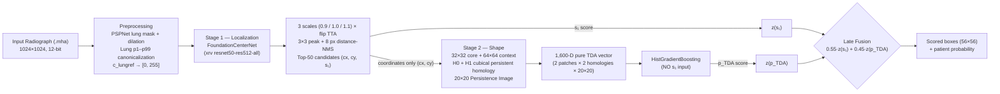
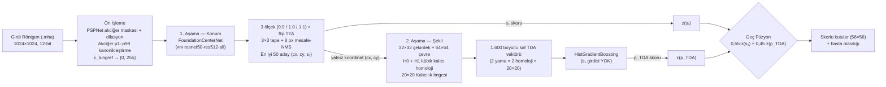

[English](#en) | [Türkçe](#tr)

---

<a id="en"></a>
# NODE21 — Two-Stage Pulmonary Nodule Detection (Deep Learning + Topological Data Analysis)

A two-stage detection system that **locates** pulmonary nodule candidates in chest radiographs (CXR) and **re-ranks** them via **topological shape analysis** to suppress false positives.

* **Stage 1 (Localization):** A CenterNet detector built on a CXR foundation backbone (`torchxrayvision` `resnet50-res512-all`) identifies the top 50 suspicious locations per radiograph and produces fixed `56×56` candidate boxes.
* **Stage 2 (Shape):** Around each candidate, `32×32` (core) and `64×64` (context) patches are cropped; a 1,600-dimensional pure topological representation is extracted via **cubical persistent homology** and scored by a gradient-boosted classifier (`HistGradientBoostingClassifier`).
* **Late Fusion:** Standardized scores from both stages are combined with fixed weights:
  `S = σ(0.55 · z(s₁) + 0.45 · z(p_TDA))`.

---

## Architecture and Design Rationale



Key architectural decisions and their rationale:

1. **Division of labor between stages (localization vs. shape):**
   The Stage-1 detector locates lesions with high recall (`Recall@K50 = 99.1%` on validation, `95.3%` on external JSRT), but remains vulnerable to false positives at tight false-positive budgets and across unseen hospitals. Conversely, cubical TDA in Stage 2 does not directly encode pixel coordinates and therefore cannot localize boxes on its own (e.g., on external JSRT it reaches `0.970` patient-level AUC alone, yet only `2.7%` `S@0.25`), while strongly distinguishing whether the intensity topology inside a candidate patch belongs to a true nodule. Thus, the two stages solve "where is it?" and "is its shape consistent with a nodule?" separately.
2. **Withholding the Stage-1 score from Stage 2 (bias isolation):**
   Stage 1 passes only candidate coordinates `(cx, cy)` to Stage 2; the Stage-1 confidence/heatmap score `s₁` is **never** included as an input feature to the Stage-2 classifier (`stage1_score_included = False`). Because the two stages operate on fundamentally different feature spaces (Stage 1: CNN texture/context, Stage 2: topological persistence), feeding `s₁` into Stage 2 causes the tree ensemble to inherit and amplify Stage 1's false-positive bias. Computing both scores independently and merging them only at the final z-score fusion keeps inter-branch correlation low (`r(p_TDA, s₁) ≈ 0.22`) and preserves fusion gain.
3. **Whole-lung canonicalization instead of local patch min–max (`c_lungref`):**
   Stretching each `32×32` or `64×64` patch independently to `[0, 255]` artificially inflates minor background noise in healthy parenchyma to nodule-like contrast. Instead, intensity normalization is performed once across the patient's entire lung mask using `p1–p99` percentiles. This step also eliminates quantization collapse where 12-bit radiographs divided by a 16-bit ceiling (`65535`) were effectively compressed to ~4 bits.
4. **Dual scale (`32×32` + `64×64`) and pure topological representation (1,600-D):**
   The `32×32` patch captures the core topology of the candidate, while the `64×64` patch captures its contrast against surrounding parenchyma and vessels. While a small CNN operating on raw pixels of the exact same patches stays at `0.652` AUC, `H0/H1` Persistence Images achieve `0.926` AUC on the same candidates. Four auxiliary spatial-position columns were dropped after showing no measurable patient-level gain in-domain; patch-level radial, Euclidean distance transform (EDT), and Vietoris-Rips graph filtrations were also evaluated, but proved sensitive to box-centering shifts on external sites, so the main architecture remains on the simplest and best-generalizing **pure 1,600-D** representation.
5. **Fixed box size and frozen fusion parameters:**
   Fusion z-score reference statistics (`mean/std`) and weights (`0.55 / 0.45`) are frozen once on the validation split and never re-tuned on test or external data. Box size is kept fixed at `56×56 px` (a learned dynamic radius head did not improve the official `IoU > 0.20` metric).

---

## Results

### In-Domain (NODE21 — `56×56` boxes, official `IoU > 0.20` matching)

**Test split — 734 patients / 229 lesions:**

| Metric | Stage 1 Only | **Stage 1 + Stage 2 (Fusion)** |
| :--- | ---: | ---: |
| Patient AUC (top-1) | 0.9446 | **0.9661** |
| `rank_metric` (`0.75·AUC + 0.25·S@0.25`) | 0.8842 | **0.9047** |
| S@0.125 (sensitivity at 0.125 FP/image) | — | 60.7% |
| S@0.25 | 70.3% | **72.1%** |
| S@0.50 | 76.4% | 76.4% |

**Validation split — 734 patients / 231 lesions:** Fusion Patient AUC **0.9836**, `rank_metric` **0.9304**, S@0.25 **77.1%**, S@0.50 **79.7%**. Stage-1 candidate recall: **Recall@K20 `0.9827` · Recall@K50 `0.9913`**.

### External Validation (Unseen Hospitals)

| Cohort | Zero-Shot | Site Calibration (`N=160` local labels) |
| :--- | :--- | :--- |
| **Pure JSRT** *(Japan, 149 nodule + 93 control = 242, 12-bit `.mha`)* | Recall@K10 **86.6%** · K50 **95.3%** · AUC **0.9197** (top-1) / **0.9652** (noisy-OR) · S@0.25 **52.4%** · `rank_metric` **0.8206** | AUC **0.9662** · S@0.25 **56.4%** · S@0.50 **66.4%** · `rank_metric` **0.8656** |
| **VinDr-CXR** *(Vietnam, 400 images, 8-bit JPEG)* | AUC **0.6376** | AUC **0.7935** |

> On the lossless 12-bit external site (JSRT), zero-shot performance starts strong and reaches in-domain test levels with a small number of local labels. On the lower-quality 8-bit JPEG site (VinDr), zero-shot starts lower, while the relative gain from site calibration is larger.

---

## Setup and Expected Data Layout

```powershell
python -m venv venv
venv\Scripts\pip install -r requirements.txt
```

Core dependencies: `torch`, `torchxrayvision`, `gudhi`, `scikit-learn`, `SimpleITK`, `scipy`.

Expected data paths (NODE21 public training set — not included in the repository):

| Path | Contents |
| :--- | :--- |
| `dataset_node21/cxr_images/proccessed_data/images/{pid}.mha` | `1024×1024` uint16 radiographs (4,882 patients) |
| `data/processed/zones/patients/{pid}/mask_5zones.mha` | Lung masks (PSPNet output) |
| `data/processed/splits_v2/patient_splits.csv` | Patient-level train / val / test split (`3,414 / 734 / 734`) |
| `data/processed/features_v5_1/lung_p1p99.json` | Per-patient lung `p1–p99` intensity bounds |

Model checkpoints and large caches (`artifacts/v6_two_stage/checkpoints/`) are excluded from version control and are reproduced via the commands below.

---

## Usage

### 1) Scientific Pipeline (Reproducing Reported Results)

```powershell
# Stage-1 detector training (18 epochs: 5 frozen + 13 differential fine-tuning)
python pipelines/v6_two_stage/v6_6_train_foundation.py
# -> artifacts/v6_two_stage/checkpoints/M5_foundation.pt

# Stage-2 candidate + PI cache and pure 1,600-D HGB bundle
python pipelines/v6_two_stage/v6_9l_spatial_ablation.py
python pipelines/v6_two_stage/v6_9m_pure1600_seal.py
# -> artifacts/v6_two_stage/checkpoints/stage2_foundation_tda_hgb_pure1600.joblib
# -> artifacts/v6_two_stage/v6_9m_pure1600_seal.json
```

### 2) Single-Image Inference and Docker Container

```powershell
# Build full-data deployment bundle and freeze contract
python pipelines/v6_two_stage/v6_7_train_fulldata.py
python pipelines/v6_two_stage/v6_7_build_fulldata_stage2.py
python pipelines/v6_two_stage/v6_7_freeze_config.py

# Single-image inference / quick smoke test
python pipelines/v6_two_stage/v6_7_submission_infer.py --image <radiograph.mha>
python pipelines/v6_two_stage/v6_7_submission_infer.py --smoke
```

For the offline (`--network=none`) Grand-Challenge container setup and I/O contract, see [`submission_docker/README.md`](submission_docker/README.md).

---

## Repository Structure

```text
pipelines/v6_two_stage/     Training, inference, and ablation scripts for the two-stage pipeline
src/node21_tda/             TDA feature extractor, lung segmentation, and data utilities
artifacts/v6_two_stage/     JSON evaluation logs (checkpoints and caches are gitignored)
submission_docker/          Grand-Challenge Docker container (Dockerfile, process.py)
data/, dataset_node21/      Data directories (excluded from version control)
```

---

## Limitations and Known Constraints

1. **Pretraining source overlap:** NODE21 is compiled from public CXR corpora, and the foundation backbone (`xrv resnet50-res512-all`) saw part of those corpora (82.9% of positives) during box-free classification pretraining. The official evaluation metric is bounding-box based; additional controls were run with a non-overlapping backbone and on the fully isolated JSRT cohort (242 patients).
2. **Fixed box geometry:** With a fixed `56×56` box, a small fraction of very large/small lesions (`1.7%` in test, `4.3%` in validation) cannot geometrically satisfy `IoU > 0.20`.
3. **Internal test split reuse:** The NODE21 internal test split was evaluated multiple times across development iterations and should be interpreted as a reused internal evaluation split rather than a single-use untouched test set.
4. **Deployment container difference:** While the scientific pipeline uses the pure 1,600-D TDA vector, the full-data container (`submission_fulldata`) packages the 1,604-D Stage-2 bundle containing 4 spatial columns (test AUC `0.9687` vs. `0.9661`, `rank_metric` `0.9045` vs. `0.9047`).
5. **External calibration requirement:** The site-calibration column in the external validation table reflects a deployment scenario where labeled examples from the target hospital are available, and should be interpreted separately from zero-shot results.

---

## Related Documents

* Technical methodology and mathematical details: [`TECHNICAL_METHOD.md`](TECHNICAL_METHOD.md)
* Grand-Challenge container guide: [`submission_docker/README.md`](submission_docker/README.md)

---
---

<a id="tr"></a>
# NODE21 — İki Aşamalı Akciğer Nodülü Tespiti (Derin Öğrenme + Topolojik Veri Analizi)

Göğüs röntgenlerinde (CXR) akciğer nodülü adaylarını **tespit eden** ve bu adayları **topolojik şekil analiziyle** yeniden sıralayıp yanlış alarmları eleyen iki aşamalı bir tespit sistemi.

* **1. Aşama (Konum):** CXR vakıf omurgalı (`torchxrayvision` `resnet50-res512-all`) bir CenterNet dedektörü, her röntgende en olası 50 şüpheli noktayı belirler ve `56×56` sabit aday kutuları üretir.
* **2. Aşama (Şekil):** Her adayın etrafından `32×32` (çekirdek) ve `64×64` (çevre) yamalar kırpılır; **kübik kalıcı homoloji (cubical persistent homology)** ile 1.600 boyutlu saf topolojik bir temsil çıkarılır ve gradient-boosting (`HistGradientBoostingClassifier`) ile puanlanır.
* **Geç Füzyon:** İki aşamanın standartlaştırılmış puanları sabit ağırlıklarla birleştirilir:
  `S = σ(0,55 · z(s₁) + 0,45 · z(p_TDA))`.

---

## Mimari ve Tasarım Mantığı



Mimariyi şekillendiren temel tasarım kararları ve gerekçeleri:

1. **İki aşamanın görev ayrımı (konum vs. şekil):**
   1. aşama dedektörü lezyonların yerini yüksek yakalama oranıyla bulur (`Recall@K50 = %99,1` doğrulama, `%95,3` dış JSRT), ancak düşük yanlış-alarm bütçelerinde ve yeni hastanelerde sahte pozitiflere açıktır. 2. aşamadaki kübik TDA ise piksel koordinatına doğrudan bakmadığı için tek başına kutu konumlandırmada zayıftır (ör. dış JSRT'de tek başına hasta AUC `0,970` iken `S@0,25` yalnızca `%2,7`), fakat bir kutunun içindeki yoğunluk topolojisinin gerçek bir nodüle ait olup olmadığını güçlü biçimde ayırt eder. İki aşama bu yüzden "nerede?" ve "şekli tutarlı mı?" sorularını ayrı ayrı çözer.
2. **1. aşama skorunun 2. aşamaya verilmemesi (önyargı izolasyonu):**
   1. aşama, 2. aşamaya yalnızca aday koordinatlarını `(cx, cy)` iletir; 1. aşamanın olasılık/ısı skoru `s₁` **hiçbir zaman** 2. aşama sınıflandırıcısının girdi sütunlarına eklenmez (`stage1_score_included = False`). İki katman farklı özellik uzaylarına (1. aşama: CNN doku/bağlam, 2. aşama: topolojik kalıcılık) baktığından, `s₁`'i 2. aşamaya girdi olarak vermek ağaç modelinin 1. aşamanın yanlış-pozitif önyargısını kopyalamasına yol açar. İki skorun ayrı üretilip yalnızca son z-füzyonda birleştirilmesi iki dal arasındaki korelasyonu düşük tutar (`r(p_TDA, s₁) ≈ 0,22`) ve füzyon kazancını korur.
3. **Yerel yama yerine akciğer-geneli kanonikleştirme (`c_lungref`):**
   Her `32×32` veya `64×64` yamayı kendi min–max değerine göre `[0, 255]` aralığına germek, homojen sağlıklı dokudaki küçük gürültüleri bile yapay olarak nodül kontrastına çıkarır. Bunun yerine normalizasyon hastanın tüm akciğer maskesi içindeki `p1–p99` yüzdelikleriyle tek seferde yapılır. Bu adım aynı zamanda 12-bit röntgenlerin 16-bit (`65535`) tavanına bölünerek ~4-bit'e sıkışması sorununu da giderir.
4. **Çift ölçek (`32×32` + `64×64`) ve saf topolojik temsil (1.600 boyut):**
   `32×32` yama adayın çekirdek yapısını, `64×64` yama ise çevre parankim ve damar bağlamıyla kontrastını taşır. Aynı yamaları ham piksel olarak inceleyen küçük bir CNN `0,652` AUC'de kalırken, `H0/H1` Kalıcılık İmgeleri (Persistence Image) aynı adaylarda `0,926` AUC üretir. Ek uzamsal konum sütunları (4 özellik) kurum içinde ek kazanç getirmediği için çıkarılmış; kutu-içi radyal, uzaklık dönüşümü (EDT) ve Vietoris-Rips graf filtrasyonları da sınanmış, ancak dış hastanede kutu-merkezleme farkına duyarlı oldukları görüldüğünden ana mimari en sade ve genellenebilir olan **saf 1.600** temsilde bırakılmıştır.
5. **Sabit kutu ve dondurulmuş füzyon parametreleri:**
   Füzyon z-referansı (`mean/std`) ve ağırlıklar (`0,55 / 0,45`) doğrulama kümesinde bir kez sabitlenir; testte veya harici veride yeniden ayarlanmaz. Kutu boyutu sabit `56×56 px` olarak kullanılır (öğrenilmiş dinamik yarıçap kafası resmî `IoU > 0,20` metriğinde ek artış sağlamamıştır).

---

## Sonuçlar

### Kurum İçi (NODE21 — 56×56 kutu, resmî `IoU > 0,20` eşleşmesi)

**Test kümesi — 734 hasta / 229 lezyon:**

| Ölçüt | Yalnız 1. Aşama | **1. + 2. Aşama (Füzyon)** |
| :--- | ---: | ---: |
| Hasta AUC (top-1) | 0,9446 | **0,9661** |
| `rank_metric` (`0,75·AUC + 0,25·S@0,25`) | 0,8842 | **0,9047** |
| S@0,125 (0,125 yanlış alarm/röntgen) | — | %60,7 |
| S@0,25 | %70,3 | **%72,1** |
| S@0,50 | %76,4 | %76,4 |

**Doğrulama kümesi — 734 hasta / 231 lezyon:** Füzyon Hasta AUC **0,9836**, `rank_metric` **0,9304**, S@0,25 **%77,1**, S@0,50 **%79,7**. 1. aşama aday yakalama: **Recall@K20 `0,9827` · Recall@K50 `0,9913`**.

### Dış Doğrulama (Eğitimde Hiç Görülmemiş Hastaneler)

| Kohort | Sıfır-Eğitim (Zero-Shot) | Yerel Etiketle Kalibrasyon (`N=160`) |
| :--- | :--- | :--- |
| **Saf JSRT** *(Japonya, 149 nodüllü + 93 sağlıklı = 242, 12-bit `.mha`)* | Recall@K10 **%86,6** · K50 **%95,3** · AUC **0,9197** (top-1) / **0,9652** (noisy-OR) · S@0,25 **%52,4** · `rank_metric` **0,8206** | AUC **0,9662** · S@0,25 **%56,4** · S@0,50 **%66,4** · `rank_metric` **0,8656** |
| **VinDr-CXR** *(Vietnam, 400 görüntü, 8-bit JPEG)* | AUC **0,6376** | AUC **0,7935** |

> Kayıpsız 12-bit dış merkezde (JSRT) sıfır-eğitim performansı yüksek başlamakta ve az sayıda yerel etiketle kurum içi test düzeyine ulaşmaktadır. Düşük kaliteli 8-bit JPEG merkezde (VinDr) sıfır-eğitim düşük başlamakta, ancak yerel kalibrasyonun sağladığı göreli artış daha büyük olmaktadır.

---

## Kurulum ve Veri Düzeni

```powershell
python -m venv venv
venv\Scripts\pip install -r requirements.txt
```

Temel bağımlılıklar: `torch`, `torchxrayvision`, `gudhi`, `scikit-learn`, `SimpleITK`, `scipy`.

Beklenen veri yolları (NODE21 halka açık eğitim kümesi — depoda yer almaz):

| Yol | İçerik |
| :--- | :--- |
| `dataset_node21/cxr_images/proccessed_data/images/{pid}.mha` | `1024×1024` uint16 röntgenler (4.882 hasta) |
| `data/processed/zones/patients/{pid}/mask_5zones.mha` | Akciğer maskeleri (PSPNet çıktısı) |
| `data/processed/splits_v2/patient_splits.csv` | Hasta düzeyi train / val / test bölünmesi (`3.414 / 734 / 734`) |
| `data/processed/features_v5_1/lung_p1p99.json` | Hasta başına akciğer `p1–p99` yoğunluk sınırları |

Model ağırlıkları ve büyük önbellekler (`artifacts/v6_two_stage/checkpoints/`) sürüm kontrolü dışındadır; aşağıdaki komutlarla yeniden üretilir.

---

## Kullanım

### 1) Bilimsel Hat (Raporlanan Sonuçların Yeniden Üretimi)

```powershell
# 1. Aşama dedektör eğitimi (18 epoch: 5 donuk + 13 diferansiyel ince ayar)
python pipelines/v6_two_stage/v6_6_train_foundation.py
# -> artifacts/v6_two_stage/checkpoints/M5_foundation.pt

# 2. Aşama aday + PI önbelleği ve saf 1.600 HGB paketinin üretimi
python pipelines/v6_two_stage/v6_9l_spatial_ablation.py
python pipelines/v6_two_stage/v6_9m_pure1600_seal.py
# -> artifacts/v6_two_stage/checkpoints/stage2_foundation_tda_hgb_pure1600.joblib
# -> artifacts/v6_two_stage/v6_9m_pure1600_seal.json
```

### 2) Tek Görüntü Çıkarımı ve Docker Konteyneri

```powershell
# %100 veriyle dağıtım paketini üret ve sözleşmeyi dondur
python pipelines/v6_two_stage/v6_7_train_fulldata.py
python pipelines/v6_two_stage/v6_7_build_fulldata_stage2.py
python pipelines/v6_two_stage/v6_7_freeze_config.py

# Tek görüntü çıkarımı / hızlı öz-test
python pipelines/v6_two_stage/v6_7_submission_infer.py --image <rontgen.mha>
python pipelines/v6_two_stage/v6_7_submission_infer.py --smoke
```

Çevrimdışı (`--network=none`) Grand-Challenge konteyner kurulumu ve girdi/çıktı sözleşmesi için bkz. [`submission_docker/README.md`](submission_docker/README.md).

---

## Depo Yapısı

```text
pipelines/v6_two_stage/     İki aşamalı hattın eğitim, çıkarım ve ablasyon betikleri
src/node21_tda/             TDA özellik çıkarıcı, akciğer segmentasyonu ve veri yardımcıları
artifacts/v6_two_stage/     JSON ölçüm kayıtları (ağırlık ve önbellekler gitignore altında)
submission_docker/          Grand-Challenge Docker konteyneri (Dockerfile, process.py)
data/, dataset_node21/      Veri dizinleri (sürüm kontrolü dışı)
```

---

## Sınırlar ve Bilinen Kısıtlar

1. **Ön-eğitim kaynak örtüşmesi:** NODE21 açık kaynaklı CXR veri setlerinden derlenmiştir ve kullanılan vakıf omurga (`xrv resnet50-res512-all`) bu korpusların bir kısmını (pozitiflerin `%82,9`'u) kutusuz sınıflandırma ön-eğitiminde görmüştür. Resmî ölçüt kutu tabanlıdır; ayrıca ilgili veri setlerini görmemiş temiz omurga ve tam izole JSRT (242 hasta) deneyleriyle kontrol edilmiştir.
2. **Sabit kutu geometrisi:** `56×56` sabit kutu ile çok büyük/küçük lezyonların küçük bir kısmı (testte `%1,7`, doğrulamada `%4,3`) geometrik olarak `IoU > 0,20` sınırına ulaşamaz.
3. **Test kümesi kullanımı:** NODE21 iç test bölmesi geliştirme döngüsü boyunca birden fazla kez değerlendirilmiştir; tek seferlik "dokunulmamış" testten ziyade yeniden kullanılan iç değerlendirme bölmesi olarak okunmalıdır.
4. **Dağıtım konteyneri farkı:** Bilimsel hat saf 1.600 TDA vektörünü kullanırken, tam-veriyle paketlenmiş konteyner (`submission_fulldata`) 4 uzamsal sütun içeren 1.604 boyutlu 2. aşama paketini kullanır (testte AUC `0,9687` vs `0,9661`, `rank_metric` `0,9045` vs `0,9047`).
5. **Harici kalibrasyon koşulu:** Dış doğrulama tablosundaki kalibrasyon sütunu hedef hastaneden etiketli örnek temin edilebildiği senaryoyu yansıtır; sıfır-eğitim sütunundan ayrı değerlendirilmelidir.

---

## İlgili Belgeler

* Yöntem ve matematiksel ayrıntılar: [`TECHNICAL_METHOD.md`](TECHNICAL_METHOD.md)
* Grand-Challenge konteyner kılavuzu: [`submission_docker/README.md`](submission_docker/README.md)
