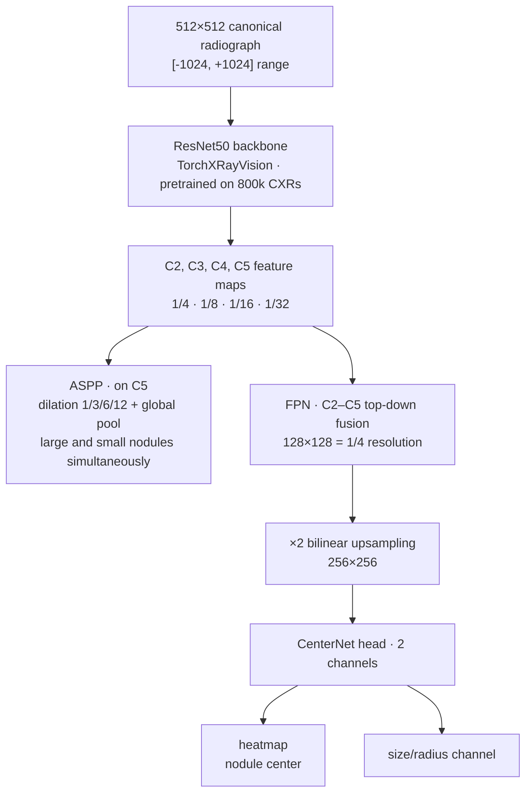
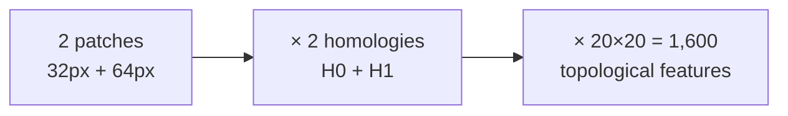
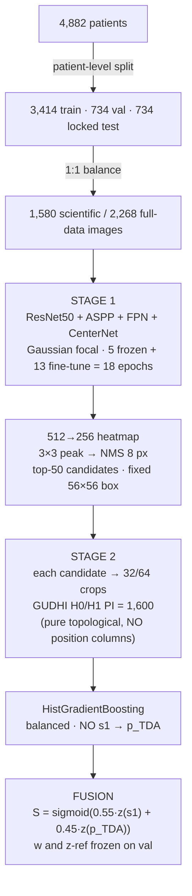
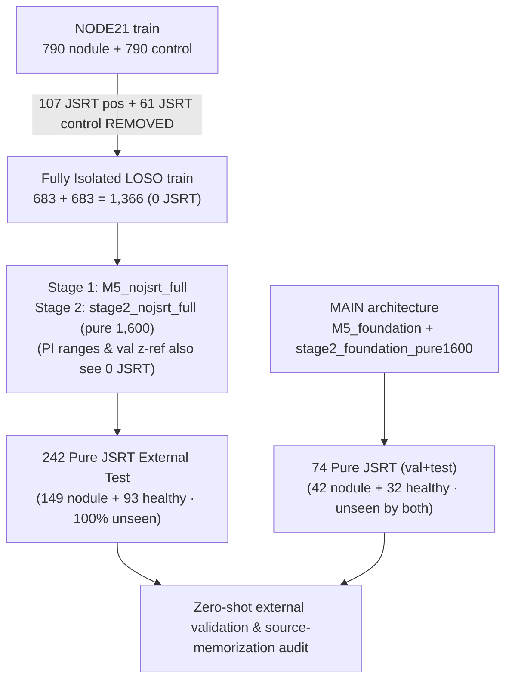
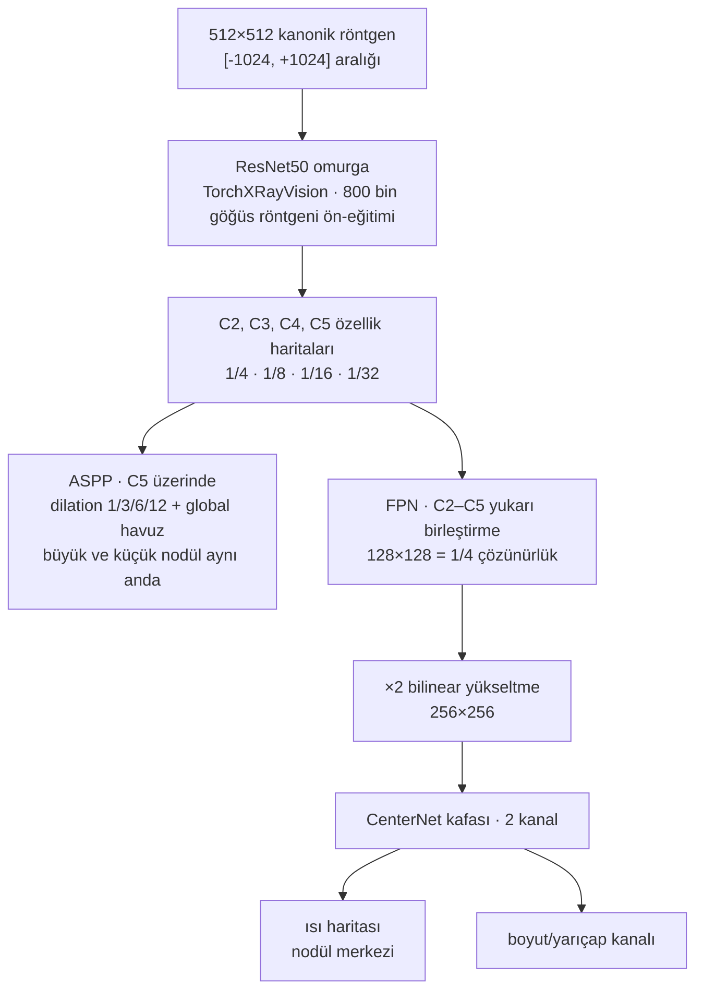
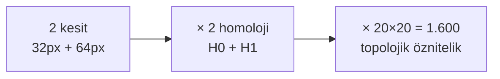
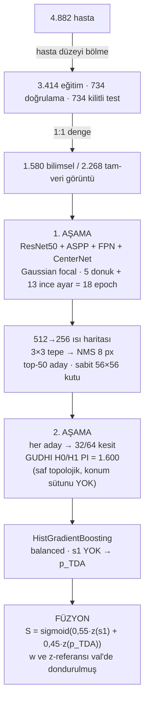
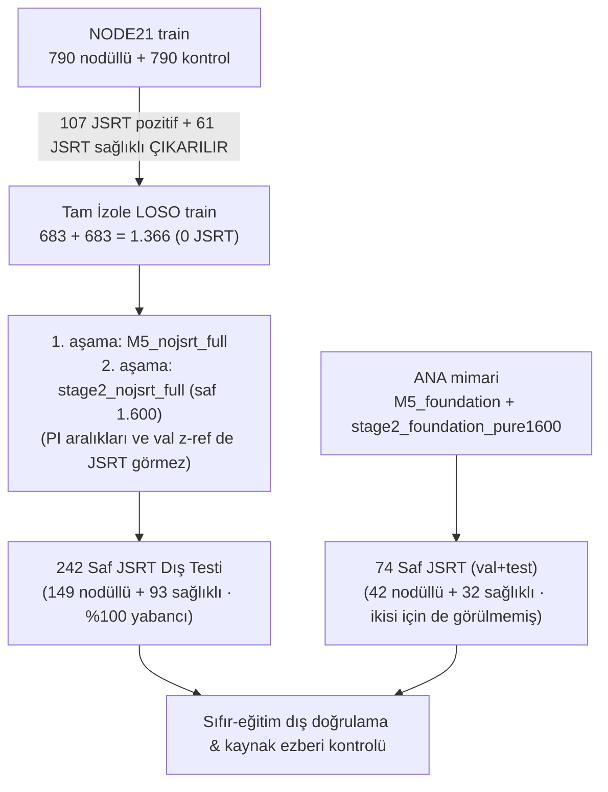

[English](#technical-method--node21-nodule-detection-two-stage-detector--local-tda) | [Türkçe](#teknik-yöntem--node21-nodül-tespiti-i̇ki-aşamalı-dedektör--lokal-tda)

---

# Technical Method — NODE21 Nodule Detection (Two-Stage: Detector + Local TDA)

> This document describes step by step **how the system is built**: data preparation, Stage-1
> detector architecture and training, Stage-2 TDA candidate pool construction, and leak-free
> fusion of the two stages. All numbers are verified against the code and logged experimental reports.
>
> ⚠️ **Two corrections:** Two statements in an earlier draft did not match the code; the accurate
> versions are marked with 🔧 in their respective sections (scope of Phase 2 and fate of the size head).

---

## 1. Data Preparation and Leak-Free Splitting (Foundation)

The public NODE21 training set contains **4,882 patients** (1,134 nodule-positive, 3,748 clean controls).

**Patient-level split.** Splitting is performed at the **patient** level rather than randomly across
images: all images belonging to a patient remain in a single split. This prevents the same patient's
anatomy from appearing in both training and testing and artificially inflating scores. Result:

| Split | Patients | Purpose |
| :--- | ---: | :--- |
| **Train** | 3,414 | Model learns here |
| **Validation** | 734 | **All design decisions** are made here |
| **Locked test** | 734 | Evaluation only (no tuning) |

**1:1 balancing.** The dataset is naturally imbalanced (1,134 nodule-positive vs. 3,748 controls).
If trained as-is, the model drifts toward predicting "healthy" for everything. Therefore, during
training **each nodule-positive patient is paired with one clean control** sampled from the same
split with a fixed seed (42):

* **Scientific model** (reported metrics): **790 + 790 = 1,580** images from the train split.
* **Full-data deployment model**: **1,134 + 1,134 = 2,268** images from all patients.

In both cases, the nodule:control ratio is **1:1**.

---

## 2. Stage 1 — Candidate-Generating Detector and Two-Phase Training

### 2.1 Architecture



The heatmap is trained with **Gaussian Focal Loss** (CenterNet standard: push toward 1 on positive
centers, toward 0 on background, down-weighting easy negatives). The size channel is supervised via
regression **only within the Gaussian-positive nodule region** (not across the entire image) —
otherwise millions of background pixels would dominate with a "0 size" target.

> 🔧 **Correction 1 — fate of the size branch:** During training this channel was supervised using
> the `Y>0` mask instead of `R>0`; since the radius target was populated only at the **single center
> pixel**, the head gradually collapsed toward 0 (discovered in V6.6.7: prediction ≈ 0.02 px). When
> repaired with the proper mask (`R>0`, center pixel only), it functioned as intended (val 0.9185 >
> fixed box 0.9131), **but did not change the official score on the locked test split**
> (0.8842 = 0.8842, V6.9f). Consequently, **the deployed system does not use size predictions; a
> fixed 56×56 px box is drawn for every candidate**. In other words, the architecture contains two
> output channels, but in practice the second channel (size) is unused.

### 2.2 Two-phase training (preventing catastrophic forgetting)

Goal: preserve the general radiographic representations learned from 800k chest X-rays while rapidly
adapting the new detection layers.

| Phase | Epochs | What is trained | Learning rate |
| :--- | ---: | :--- | :--- |
| **Phase 1 (warm-up)** | 1–5 | Backbone **completely frozen**; only ASPP+FPN neck and heads | 1e-3 |
| **Phase 2 (fine-tuning)** | 6–18 | **Only upper backbone blocks** (`layer3`, `layer4`) + neck + heads | backbone 1e-4 · head 1e-3 |

Total **18 epochs**, batch size 4, Cosine Annealing decaying down to `1e-5`.
**BatchNorm statistics remain frozen throughout training** (`eval` mode): `running_mean/var`
estimated over 800k chest radiographs are never corrupted.

> 🔧 **Correction 2 — differential fine-tuning, not "full network":** In Phase 2, the entire network
> is not unfrozen; `unfreeze_top()` in the code unlocks only `layer3` and `layer4` (early layers
> remain frozen). This is **differential (staged) fine-tuning**: upper blocks adapt to task-specific
> features while lower blocks retain general texture representations. Moreover, the backbone trains
> at a lower learning rate (`1e-4`) and the heads at a higher rate (`1e-3`).

---

## 3. Stage 2 — TDA Candidate Pool and Classifier

### 3.1 Candidate pool and labeling

The trained Stage-1 model is run on **training patients**, extracting the **top 50 suspicious boxes**
(top-50) per patient. In practice, **74,950 candidates** were collected from 1,580 training patients
(training pool of the deployed pure-1,600 model; the earlier 1,604 bundle used a different control
permutation yielding 74,482 candidates — same scale, both train-only).

Each candidate is labeled against ground-truth nodule boxes (Criterion-1: candidate center falls
inside the ground-truth bounding box):

* **Positive (1):** the candidate center lies inside a ground-truth nodule box.
* **Hard-negative (0):** a non-nodule region where the detector erred (vessel cross-section, rib
  shadow, hilar artifact).

Using **hard** negatives is critical: the classifier is trained not against random background, but
against the exact structures the detector itself confuses with nodules.

**Class imbalance:** only **1.72%** of the pool is positive (≈ 1:57). Among 50 candidates in a
nodule-positive patient, typically 1–2 are true positives (≈ **1:49** within a patient). This
imbalance is handled via `class_weight="balanced"` (automatic inverse-frequency weighting for the
rare class), while training patients are sampled 1:1.

### 3.2 Feature extraction (local topology)

Two patches are cropped around each candidate center: **32×32 (core)** and **64×64 (context)**. On
each patch, **cubical persistent homology** is computed with **GUDHI**:

* **H0** → intensity peaks (connected components)
* **H1** → loops/cavities

Each persistence diagram is rasterized into a **20×20 Persistence Image** using birth–persistence
axis ranges (`p1–p99`) **derived solely from training candidates and frozen**, with **Gaussian
smoothing** (`σ = 1.0` pixel):



**Current representation: 1,600-dimensional PURE topological vector** (2 patches × 2 homologies × 20×20 PI).
Earlier versions appended **4 spatial-position columns** (`rel_x`, `rel_y`, distance to lung bbox
center = "hilum proxy", distance to lung mask boundary = "pleura proxy") ⇒ 1,604. The **V6.9l
ablation** showed that these 4 columns provided no patient-level gain (±0.001 AUC; opposite signs)
and **hurt** at the candidate level (TDA-only AUC `0.9387 → 0.9242`) ⇒ dropped by Occam's razor
(V6.9m). Details and locked test results: `experiments.md` §V6.9.13–14.

> 🧪 **Alternative patch-level filtrations tested and rejected (V6.9u).** Two blind spots of raw
> intensity filtration (`255 − I`) — insensitivity to the **patch center** and to **object
> thickness** — were tested via three new representations: **M1 radial** (`F = clip((255−I) + 60·r_norm)`,
> patch-centered; 424 features), **M2 EDT / geometric thickness** (`F = −EDT(q70)` and
> intensity-weighted `F_geo`; 560), and **M3 Vietoris-Rips graph** (`48` nodes,
> `d = √(Δu² + Δv² + 1.5·ΔI²)`, `max_edge = 2.5`; 296). Each arm trained its own HGB **from
> scratch** across two tracks (uncalibrated 242 Pure JSRT + NODE21 Val 734) with locked `w_tda = 0.45`.
> **Result: none improved fusion** (Pure JSRT fusion `rank_metric` `0.8206 → best 0.8182`; Val
> `0.9304 → 0.9338`, where the same arm dropped `−0.0024` on JSRT) ⇒ **KILL**, locked test not
> opened. However, **standalone** box blindness was demonstrably broken: TDA-only `S@0.25` rose from
> **2.7% → 6.7% (2.5×)** on Pure JSRT and **12.1% → 20.4% (1.7×)** on Val ⇒ confirming that the
> `2.7%` blindness in §V6.9.17 was indeed caused by **lack of center + thickness information**. The
> **most likely explanation** for why this did not transfer to fusion was also measured: the new
> representations **increased correlation with Stage 1** (`r(p_TDA, s1)`: `0.219 → 0.269` on Val;
> `0.230 → 0.256` on JSRT; absolute level ≤ 0.27) ⇒ moving closer to what Stage 1 already encodes.
> (Correlational observation; causality was not separately tested.)

> ⚠️ **HISTORICAL RECORD — removed 4 spatial proxies (versions v6.1–v6.9l).** The definitions below
> are **no longer used**; they were audited in V6.9l and removed in V6.9m. They are kept for
> reference so readers inspecting earlier version numbers know what those columns represented. The
> two "distances" are **geometric proxies, not anatomical measurements**; the true hilum (main
> vascular root) is **not detected**. Definitions ([`v6_1_stage2.py`](pipelines/v6_two_stage/v6_1_stage2.py)
> `_spatial()`):
>
> | Feature | How it is computed in code | What it actually measures |
> | :--- | :--- | :--- |
> | `rel_x`, `rel_y` | `(cx − x0)/w`, `(cy − y0)/h` — normalized position inside **lung mask bbox** | Relative position within the lung region |
> | `hilus` | `‖(cx,cy) − bbox center‖ / bbox diagonal` | Distance to **bbox center** (medial midline + mid-height) — a *proxy* for the hilum, not the hilum itself |
> | `plevra` | `distance_transform_edt(lung mask)[cy,cx] / 30` | Distance to the **nearest non-lung pixel** |
>
> Two limitations: (i) `hilus` also marks medial candidates **above/below the hilum** as "close to
> hilum" (y-axis is imprecise); (ii) the `plevra` distance transform merges chest wall, diaphragm,
> **and mediastinum** boundaries into a single scalar ⇒ "near chest wall" and "near mediastinum" are
> conflated (`rel_x` only partially separates them). Furthermore, **30 px** is a normalization
> constant, not a calibrated physical distance. The mask originates from PSPNet; the "5 zones" are
> vertical slices of lung height (right: 3, left: 2), not true lobar segmentations, and the spatial
> features used **only their union** (`zone > 0`).
>
> 📊 **Why they were removed (V6.9l, val-only):** no patient-level contribution could be demonstrated
> — across 1,600 (no position) vs. 1,604 (legacy) vs. 1,606 (anatomical), fusion AUC differed by
> **±0.001** and `rank_metric` by **±0.0025** with **opposite signs**. At the candidate level,
> position columns **hurt** (TDA-only AUC `0.9387 → 0.9242`). Anatomical coding using explicit
> medial/lateral borders also failed to beat the proxy (`−0.0008`).

> ⚠️ Patches are **never resized** and remain fixed at 32/64 px. The reason was measured directly:
> interpolation (bilinear resize) destroys H1 loops — in V5.1, scale normalization dropped TDA from
> `0.9211 → 0.8539`. In addition, variable crop sizes introduce a "size confound" (E3.6: `0.994 → 0.687`).

### 3.3 Classifier

The **1,600-dimensional** vector is scaled with **StandardScaler**, followed by
**HistGradientBoostingClassifier** (`max_iter=200`, `learning_rate=0.08`,
`class_weight="balanced"`). Output: candidate probability `p_TDA` of being a true nodule.

> ℹ️ **Current version (V6.9m) — pure 1,600:** the deployed bundle is
> `checkpoints/stage2_foundation_tda_hgb_pure1600.joblib`; its input consists of **1,600 pure
> topological features only** (no position columns). On the locked test split, official `rank_metric`
> is **0.9047** (1,604 version: `0.9045`) — equal; meanwhile `S@0.5` is **0.7642** vs. `0.7904`
> (`−2.6` points). The previous 1,604 bundle is **preserved without deletion** as
> `stage2_foundation_tda_hgb.joblib`.

> ℹ️ **Candidate distribution alignment (V6.9i):** This classifier is trained on **Stage 1's own
> candidate distribution**. An earlier version had been trained on candidates from the M5 (ImageNet)
> detector; that mismatch cost `0.0075` `rank_metric` on the locked test split. Retraining on
> Foundation candidates eliminated the gap (test: `rank_metric` `0.8970 → 0.9045`, AUC `0.9645 → 0.9687`).

---

## 4. Avoiding the Overconfidence (Stacking) Trap During Fusion

The naive approach is to feed Stage 1's score as an extra input feature into Stage 2 so that Stage 2
learns "how much to trust Stage 1". This creates **two layers of leakage**:

1. **In-sample score inflation during training:** Stage 1's scores are inflated on its own **training
   data** (the detector is overconfident on memorized examples). Stage 2 mistakes this inflated score
   for ground truth and assigns it excessive weight.
2. **Learned fusion coefficients** are then fitted to this biased distribution ⇒ performance looks
   strong on validation but degrades on unseen data.

**Our solution (structural safeguard since V6.7):**

* ✅ **Independent training:** Stage 2's feature matrix **never contains Stage 1's score** — only
  the 1,600 pure topological PI features (enforced in the bundle via `stage1_score_included = False`).
* ✅ **Locked fixed weight:** The two scores are combined using a fixed weight selected on the
  **validation split** and **never re-fitted**:

```
z(s1) and z(p_TDA): standardized using mean/std frozen on the validation split
S = sigmoid( 0.55 · z(s1) + 0.45 · z(p_TDA) )
```

`w = 0.55` is **locked**; it is never re-learned on any split (train/val/test). The z-normalization
reference is also frozen on **validation**; no statistics are computed from the test distribution
(zero transductive leakage).

> 📌 **Why a fixed weight?** A learned logistic/stacking combiner easily overfits on a modest number
> of patients. A fixed, pre-validated weight is both leak-free and fully reproducible.

> ⚖️ **Weight sensitivity (V6.9s):** Sweeping `w_tda ∈ [0.40 … 0.70]` shows that patient AUC rises
> with `w_tda` (Test `0.966 → 0.978`), whereas localization metrics peak at `w_tda ≈ 0.45–0.50` and
> drop for `≥ 0.60` (Test `S@0.25`: `72.1% → 61.6%`): TDA does not alter box coordinates, it
> re-ranks a fixed candidate pool, and as its weight grows, low-ranked Stage-1 false candidates rise
> to rank 1. The locked `w = 0.55 / 0.45` was kept unchanged.

---

## 5. Summary Pipeline



**Locked test result (leak-free, untuned):** Stage-1 only `rank_metric` **0.8842** / AUC **0.9446**
→ two-stage fusion `rank_metric` **0.9045** / AUC **0.9687** (1,604 version) · **0.9047** / `0.9661`
and `S@0.5 = 0.7642` (**pure 1,600, V6.9m — deployed version**).

---

## 6. External Generalization — Leaving One Source Completely Out (LOSO · V6.9r Pure JSRT)

All numbers above were measured **within our dataset**: NODE21 is compiled from four public sources
and the model sees patients from **all** of them during training. To honestly answer *"how well does
it generalize to an unseen hospital?"*, one entire source must be **completely removed from
training**.

JSRT (Japanese source) was chosen for this test. By scanning the unique physical signature of JSRT
in the raw `.mha` headers (`DimSize = 2048 2048`, `ElementSpacing = 0.175 mm/px`, `MET_USHORT`), we
identified not only the **149 JSRT nodule-positive** radiographs in NODE21, but also all **93
original JSRT healthy control radiographs** (`train: 61, val: 18, test: 14`) that had been mixed
into the shared `node21_control` pool (**149 nodule + 93 healthy = 242 pure JSRT patients**). All
149 JSRT positives and all 93 JSRT healthy controls were removed from both training and validation
calibration (`V6.9r`: 0 JSRT positives, 0 JSRT negatives in training):



**Result (`V6.9r`, pure 1,600 TDA):** Zero-shot performance of the JSRT-free model on the **242 Pure
JSRT (149 nodule + 93 healthy)** external cohort: **Recall@K10 0.8658 (86.6%) · K20 0.8926 (89.3%)
· K50 0.9530 (95.3%) · Patient AUC 0.9197 (Top-1) / 0.9652 (Noisy-OR) · S@0.25 0.5235 (52.4%) ·
S@0.50 0.5839 (58.4%) · `rank_metric` 0.8206**.

| Cohort / Metric (Pure 1,600 TDA) | Stage 1 Only | Stage 2 Only (TDA) | Two-Stage Fusion (`w=0.55`) | Gain (`Fusion − Stage 1`) |
| :--- | ---: | ---: | ---: | ---: |
| **242 Pure JSRT** — Recall@K10 / K50 | 0.8658 / 0.9530 | — | **0.8658 / 0.9530** | — |
| **242 Pure JSRT** — Patient AUC (Top-1 / Noisy-OR) | 0.8488 / 0.8721 | **0.9704 / 0.9789** | **0.9197 / 0.9652** | **+0.0709 / +0.0931** |
| **242 Pure JSRT** — S@0.25 / S@0.50 | 0.4966 / 0.5839 | 0.0268 / 0.0604 | **0.5235 / 0.5839** | **+0.0269 / 0.0000** |
| **242 Pure JSRT** — `rank_metric` | 0.7608 | 0.7345 | **0.8206** | **+0.0598** |
| **74 Pure JSRT (`val+test`)** — Fusion AUC (`V6.9r` vs. Main) | — | — | **0.9077 vs. 0.9010** | **Δ = +0.0067 (no memorization)** |

> 🔑 **Methodological closure (`V6.9k → V6.9r`):** In earlier `V6.9k/k4` runs (where only the 107
> JSRT positives were excluded and 14 JSRT healthy controls remained in training negatives, evaluated
> on 149 JSRT + 250 mixed controls), we measured `Recall@K50 = 0.9396`, `Top-1 AUC = 0.9316`
> (`0.9395` with 1,604). When all 61 JSRT healthy controls were also removed from training (`V6.9r`;
> with the `tr_neg_clean[:683]` slice and within the single-seed `±0.02` training band), JSRT recall
> remained stable within noise (**94.0% → 95.3%**, `K10: 85.2% → 86.6%`, +2 lesions). While Stage-2
> TDA alone achieved **0.9704** patient AUC, it cannot place boxes on its own because it does not
> encode box centers (`S@0.25 = 2.7% · rank_metric = 0.7345`); combining both stages at locked
> `w = 0.55` lifted both localization (`S@0.25: 49.7% → 52.4%`) and patient discrimination
> (`0.8488 → 0.9197`, `rank_metric: 0.7608 → 0.8206`). On the **74-patient (`val+test`: 42 nodule +
> 32 healthy) pure JSRT subset** unseen by either model, no source-memorization advantage remained
> between the JSRT-free model (`0.9077` Top-1 / `0.9621` Noisy-OR) and the main model (`0.9010`
> Top-1 / `0.9568` Noisy-OR; **`Δ = +0.0067`**).

**Reporting rule.** Locked test numbers are labeled **`in-fold`** (valid within the dataset). For
*out-of-source generalization* claims, **242 Pure JSRT (`V6.9r`)** and **VinDr (`V6.9j2`)** numbers
are reported ([`v6_9r_true_jsrt_external.py`](pipelines/v6_two_stage/v6_9r_true_jsrt_external.py)).

> 🎯 **Site calibration symmetry (`V6.9t`).** Alongside zero-shot rows, we evaluated site calibration
> using **N labeled images** from the target hospital (5-fold stratified CV, zero leakage into test
> folds): VinDr (8-bit JPEG) **0.6376 → 0.7935** (+15.6 points); JSRT (12-bit `.mha`)
> **0.9006 → 0.9662** (+6.6 points; +4.7 over the published 3-TTA baseline). Gains come almost
> entirely from Stage 1 (`S@0.25: 0.4899 → 0.5772`), and **10 labeled images capture 55% of the gain,
> while 40 capture 76%**. These rows **require local labels** and are never used for zero-shot claims.

---
---

# Teknik Yöntem — NODE21 Nodül Tespiti (İki Aşamalı: Dedektör + Lokal TDA)

> Bu belge, sistemin **nasıl inşa edildiğini** adım adım anlatır: veri hazırlığı, 1. aşama
> dedektörün mimarisi ve eğitimi, 2. aşama TDA havuzunun kurulması ve iki aşamanın sızıntısız
> birleştirilmesi. Bütün sayılar kodla ve kayıtlı deney raporlarıyla doğrulanmıştır.
>
> ⚠️ **İki düzeltme:** Taslak metindeki iki ifade kodla uyuşmuyordu; doğrusu ilgili bölümlerde
> 🔧 ile işaretlendi (2. fazın kapsamı ve boyut dalının akıbeti).

---

## 1. Veri Hazırlığı ve Sızıntısız Bölünme (Temel İnşa)

Halka açık NODE21 eğitim seti **4.882 hasta** içerir (1.134 nodüllü, 3.748 temiz kontrol).

**Hasta düzeyinde bölünme.** Bölme rastgele görüntü değil, **hasta** biriminde yapılır: bir
hastanın bütün görüntüleri tek bir kümede kalır. Böylece aynı hastanın anatomisi hem eğitimde
hem testte görünüp skoru yapay olarak şişiremez. Sonuç:

| Küme | Hasta | Kullanım amacı |
| :--- | ---: | :--- |
| **Eğitim** | 3.414 | Model buradan öğrenir |
| **Doğrulama** | 734 | **Tüm tasarım kararları** burada alınır |
| **Kilitli test** | 734 | Yalnız ölçüm (ayar yapılmaz) |

**1:1 dengeleme.** Veri seti doğal olarak dengesizdir (1.134 nodüllüye karşı 3.748 kontrol).
Bu hâliyle eğitilirse model "her şeye sağlam" demeye kayar. Bu yüzden eğitimde **her nodüllü
hastaya bir temiz kontrol** eşlenir; kontroller aynı bölmeden sabit tohumla (42) seçilir:

* **Bilimsel model** (raporlanan metrikler): train bölmesinden **790 + 790 = 1.580** görüntü.
* **Tam-veri gönderim modeli**: tüm hastalardan **1.134 + 1.134 = 2.268** görüntü.

Her iki durumda da nodüllü:kontrol oranı **1:1**'dir.

---

## 2. 1. Aşama — Aday Üretici Dedektör ve İki Fazlı Eğitim

### 2.1 Mimari



Isı haritası **Gaussian Focal Loss** ile eğitilir (CenterNet standardı: pozitif bölgede
"1'e yaklaş", arka planda "0'a yaklaş", kolay örneklerin ağırlığı düşük). Boyut kanalı,
**yalnızca nodülün Gaussian-pozitif bölgesinde** (tüm görüntüde değil) regresyonla denetlenir —
aksi hâlde arka plandaki milyonlarca piksel "0 boyut" baskın çıkar.

> 🔧 **Düzeltme 1 — boyut dalının akıbeti:** Bu kanal eğitimde `R>0` değil `Y>0` maskesiyle
> denetlendi; yarıçap hedefi ise yalnız **tek merkez pikselinde** dolu olduğu için kafa
> zamanla 0'a çöktü (V6.6.7'de bulundu: tahmin ≈0,02 px). Doğru maske (`R>0`, yalnız merkez
> pikseli) ile onarıldığında çalıştı (val 0,9185 > sabit kutu 0,9131), **ama kilitli testte
> resmî skoru değiştirmedi** (0,8842 = 0,8842, V6.9f). Bu yüzden **dağıtılan sistemde boyut
> tahmini kullanılmaz; her adaya sabit 56×56 px kutu** çizilir. Yani mimaride iki kanal vardır
> ama pratikte ikinci kanal (boyut) devre dışıdır.

### 2.2 İki fazlı eğitim (unutmayı önleme)

Amaç: 800 bin röntgenin öğrettiği genel dokuyu korumak, yeni katmanları ise hızla öğretmek.

| Faz | Epoch | Ne eğitilir | Öğrenme hızı |
| :--- | ---: | :--- | :--- |
| **Faz 1 (ısınma)** | 1–5 | Omurga **tamamen donuk**; yalnız ASPP+FPN boynu ve kafalar | 1e-3 |
| **Faz 2 (ince ayar)** | 6–18 | **Yalnız omurganın üst blokları** (layer3, layer4) + boyun + kafalar | omurga 1e-4 · kafa 1e-3 |

Toplam **18 epoch**, batch 4, Cosine Annealing ile 1e-5'e kadar azalan öğrenme hızı.
**BatchNorm istatistikleri tüm eğitim boyunca donuk** (`eval` modunda): 800 bin röntgenden gelen
`running_mean/var` bozulmaz.

> 🔧 **Düzeltme 2 — "tüm ağ" değil, diferansiyel ince ayar:** Faz 2'de ağın tamamı açılmaz;
> kodda `unfreeze_top()` yalnız `layer3` ve `layer4` bloklarını açar (erken katmanlar donuk
> kalır). Buna **diferansiyel (kademeli) ince ayar** denir: üst katmanlar hedefe özgü özellikleri
> öğrenirken alt katmanlar genel doku bilgisini korur. Ayrıca omurga düşük (1e-4), kafalar
> yüksek (1e-3) hızla öğrenir.

---

## 3. 2. Aşama — TDA Veri Havuzu ve Sınıflandırıcı

### 3.1 Aday havuzu ve etiketleme

Eğitilmiş 1. aşama modeli **eğitim hastalarında** çalıştırılır; hasta başına **50 şüpheli kutu**
(top-50) alınır. Uygulamada 1.580 eğitim hastasından **74.950 aday** toplanmıştır (dağıtılan saf
1.600 modelinin eğitim havuzu; eski 1.604 bundle'ı farklı bir kontrol permütasyonuyla 74.482 aday
kullanmıştı — aynı boyut, ikisi de train-only).

Her aday, gerçek nodül kutularıyla (Kriter-1: merkez bbox içinde) karşılaştırılarak etiketlenir:

* **Pozitif (1):** kutunun merkezi bir gerçek nodülün içine düşüyor.
* **Zor-negatif / Hard-negative (0):** dedektörün yanıldığı, nodül olmayan bölge
  (damar kesiti, kaburga gölgesi, hilus artefaktı).

"Zor" negatif olması kritiktir: model rastgele arka planla değil, **kendi karıştırdığı**
yapılarla sınanır.

**Dengesizlik:** havuzun yalnızca **%1,72'si pozitiftir** (≈1:57). Nodüllü bir hastanın 50
adayından tipik olarak 1–2'si gerçektir; yani hasta içinde ≈**1:49**. Bu dengesizlik
`class_weight="balanced"` ile korunur (nadir sınıfa otomatik ağırlık) ve eğitim hastaları
1:1 seçilir.

### 3.2 Özellik çıkarımı (lokal topoloji)

Her aday merkezinden iki kesit alınır: **32×32 (çekirdek)** ve **64×64 (çevre)**. Her kesitte
**GUDHI** kütüphanesiyle **kübik kalıcı homoloji** hesaplanır:

* **H0** → parlaklık tepecikleri (bağlı bileşenler)
* **H1** → döngüler/delikler

Her diyagram, **eğitim adaylarından türetilip dondurulmuş** doğum–kalıcılık eksen aralıklarıyla
(p1–p99) ve **Gaussian yumuşatma** (σ=1,0 piksel) ile **20×20 kalıcılık imgesine** rasterize
edilir:



**Güncel temsil: 1.600 boyutlu SAF topolojik vektör.** (2 kesit × 2 homoloji × 20×20 PI.)
Daha önceki sürümlerde buna **4 uzamsal konum sütunu** ekleniyordu (`rel_x`, `rel_y`,
akciğer alanı merkezine uzaklık = "hilus vekili", akciğer maskesi sınırına uzaklık =
"plevra vekili") ⇒ 1.604. **V6.9l ablasyonu** bu 4 sütunun hasta düzeyinde katkı
sağlamadığını (±0,001 AUC; işaretler ters) ve aday düzeyinde **zarar verdiğini**
(TDA-tek AUC 0,9387 → 0,9242) gösterdi ⇒ Occam'ın usturası gereği **çıkarıldı** (V6.9m).
Ayrıntı ve kilitli test sonucu: [experiments.md](experiments.md) §V6.9.13–14.

> 🧪 **Alternatif kutu-içi filtrasyonlar denendi ve elendi (V6.9u).** Ham parlaklık filtrasyonunun
> (`255 − I`) iki körlüğü — kutunun **merkezini** ve yapının **kalınlığını** görmemesi — üç yeni
> temsille test edildi: **M1 radyal** (`F = clip((255−I) + 60·r_norm)`, kutu merkezli; 424 özellik),
> **M2 EDT / geometrik kalınlık** (`F = −EDT(q70)` ve yoğunluk-ağırlıklı `F_geo`; 560) ve
> **M3 Vietoris-Rips graf** (`48` düğüm, `d = √(Δu² + Δv² + 1,5·ΔI²)`, `max_edge = 2,5`; 296).
> Her kol kendi HGB'sini **sıfırdan** eğitti; iki kulvar (kalibresiz 242 Saf JSRT + NODE21 Val 734),
> kilitli `w_tda = 0,45`. **Sonuç: hiçbiri füzyonu iyileştirmedi** (Saf JSRT füzyon `rank_metric`
> 0,8206 → en iyi 0,8182; Val 0,9304 → 0,9338 ama aynı kol JSRT'de −0,0024) ⇒ **KILL**, kilitli test
> açılmadı. Buna karşılık **tek başına** kutu körlüğünü kırdıkları ölçüldü: TDA-tek `S@0,25`
> Saf JSRT'de **%2,7 → %6,7 (2,5×)**, Val'de **%12,1 → %20,4 (1,7×)** ⇒ §V6.9.17'deki `%2,7`'nin
> nedeni gerçekten **merkez + kalınlık bilgisizliğiymiş**. Füzyona taşınmamasının **en olası
> açıklaması** ölçüldü: yeni temsillerin **1. aşama ile korelasyonu artıyor** (`r(p_TDA, s1)`:
> 0,219 → 0,269 Val; 0,230 → 0,256 JSRT; mutlak düzey ≤0,27) ⇒ 1. aşamanın kodladığı bilgiye
> yaklaşıyorlar. (Korelasyon gözlemi; nedensellik test edilmedi.) Ayrıntı: [experiments.md](experiments.md) §V6.9.20 ·
> [ablation_matrix.md](ablation_matrix.md) §17.14.

> ⚠️ **TARİHSEL KAYIT — çıkarılan 4 uzamsal vekil (v6.1–v6.9l sürümleri).** Aşağıdaki tanımlar
> artık **kullanılmamaktadır**; V6.9l'de ölçülüp V6.9m'de kaldırılmıştır. Kayıt olarak duruyor,
> çünkü eski sürümlerin sayılarını okuyan biri bu sütunların ne olduğunu bilmelidir. Bu iki
> "mesafe" **anatomik ölçüm değil, geometrik vekildir**; gerçek hilus (ana damar kökü)
> **tespit edilmez**. Tanımlar ([`v6_1_stage2.py`](pipelines/v6_two_stage/v6_1_stage2.py)
> `_spatial()`):
>
> | Özellik | Kodda nasıl hesaplanır | Gerçekte ne |
> | :--- | :--- | :--- |
> | `rel_x`, `rel_y` | `(cx − x0)/w`, `(cy − y0)/h` — **akciğer maskesi bbox'ı** içinde normalize konum | Akciğer alanı içindeki göreli konum |
> | `hilus` | `‖(cx,cy) − bbox merkezi‖ / bbox köşegeni` | **Bbox merkezine** uzaklık (medial orta hat + orta yükseklik) — hilusun *vekilidir*, hilusun kendisi değil |
> | `plevra` | `distance_transform_edt(akciğer maskesi)[cy,cx] / 30` | **En yakın akciğer-dışı piksele** uzaklık |
>
> İki sınırlama: (i) `hilus` özelliği **hilusun üstünde/altında** ama medialde olan adayları da
> "hilusa yakın" sayar (y ekseni tam doğru değil); (ii) `plevra` sınır dönüşümü göğüs duvarı,
> diyafram **ve mediasten** sınırlarını birlikte sayar ⇒ "duvara yakın" ile "mediastene yakın" bu
> tek sayıda karışır (`rel_x` kısmen ayırır). Ayrıca **30 px** kalibre edilmiş bir mesafe değil,
> normalizasyon ölçeğidir. Maske kaynağı PSPNet'tir; "5 bölge" gerçek lob segmentasyonu değil,
> akciğer yüksekliğinin dikey dilimidir (sağ: 3, sol: 2) ve uzamsal özelliklerde **yalnızca
> birleşim** (`zone > 0`) kullanılırdı.
>
> 📊 **Neden çıkarıldı (V6.9l, yalnız val):** bu 4 konum sütununun hasta düzeyi katkısı
> **gösterilemedi** — 1600 (konum yok) vs 1604 (mevcut) vs 1606 (anatomik) kolları arasında
> füzyon AUC farkı **±0,001**, rank_metric farkı **±0,0025** ve işaretler **ters yönlü**.
> Aday düzeyinde ise konum sütunları **zarar veriyordu** (TDA-tek AUC 0,9387 → 0,9242). Gerçek
> medial/lateral kenarları kullanan anatomik kodlama da vekili geçmedi (−0,0008).
> [experiments.md](experiments.md) §V6.9.13 · kilitli test doğrulaması §V6.9.14.

> ⚠️ Kesitler **yeniden boyutlandırılmaz** ve sabit 32/64 px'tir. Sebep ölçülmüştür: interpolasyon
> (bilinear resize) H1 döngülerini siler — V5.1'de ölçek normalizasyonu TDA'yı 0,9211 → 0,8539'a
> düşürmüştü. Ayrıca değişken kesit boyutu "boyut confound'u" yaratır (E3.6: 0,994 → 0,687).

### 3.3 Sınıflandırıcı

**1.600 boyutlu** vektör **StandardScaler** ile ölçeklenir, ardından
**HistGradientBoostingClassifier** (`max_iter=200`, `learning_rate=0,08`,
`class_weight="balanced"`) eğitilir. Çıktı: adayın "gerçek nodül olma" olasılığı `p_TDA`.

> ℹ️ **Güncel sürüm (V6.9m) — saf 1.600:** dağıtılan bundle
> `checkpoints/stage2_foundation_tda_hgb_pure1600.joblib`'dir; girdisi **yalnız 1.600 saf
> topolojik** özelliktir (konum sütunu yok). Kilitli testte resmî rank_metric **0,9047**
> (1.604 sürümü: 0,9045) — eşit; buna karşılık S@0,5 **0,7642** vs 0,7904 (−2,6 puan).
> Önceki 1.604 bundle'ı `stage2_foundation_tda_hgb.joblib` olarak **silinmeden korunur**.

> ℹ️ **Aday dağılımı uyumu (V6.9i):** Bu sınıflandırıcı, 1. aşamanın **kendi aday dağılımı**
> üzerinde eğitilir. Eski bir sürüm M5 (ImageNet) dedektörünün adaylarıyla eğitilmişti; o
> uyumsuzluk kilitli testte 0,0075 rank kaybına mal oluyordu. Foundation adaylarıyla yeniden
> eğitim bunu giderdi (test: rank 0,8970 → **0,9045**, AUC 0,9645 → **0,9687**).

---

## 4. Aşırı Özgüven (Stacking) Tuzağından Kaçınarak Birleştirme

Naif yaklaşım şudur: 2. aşama modeline 1. aşamanın skorunu da özellik olarak verirsin, o da
"1. aşama ne dediyse ona güvenir". Bu **iki kat sızıntı** doğurur:

1. **Eğitimde in-sample skor:** 1. aşamanın skoru, kendi **eğitim verisinde** şişmiştir
   (model ezberlediği örneklerde aşırı özgüvenlidir). 2. aşama bu şişkin skoru "gerçek" sanıp
   ona aşırı ağırlık verir.
2. **Öğrenilen füzyon katsayısı** da bu yanlı dağılıma göre uydurulur ⇒ val'de iyi görünür,
   gerçek dağılımda çöker.

**Bizim çözümümüz (V6.7'den itibaren yapısal koruma):**

* ✅ **Bağımsız eğitim:** 2. aşamanın özellik matrisi **1. aşama skorunu içermez** —
  yalnız 1.600 saf topolojik PI. (Bundle'da `stage1_score_included = False` olarak assert edilir.)
* ✅ **Kilitli sabit ağırlık:** İki skor, **doğrulama kümesinde** belirlenen ve bir daha
  **yeniden uydurulmayan** sabit ağırlıkla birleştirilir:

```
z(s1) ve z(p_TDA): doğrulama kümesinden dondurulmuş ortalama/standart sapma ile
S = sigmoid( 0,55 · z(s1) + 0,45 · z(p_TDA) )
```

`w = 0,55` **kilitlidir**; hiçbir veri kümesinde (eğitim/doğrulama/test) yeniden öğrenilmez.
Z-normalizasyon referansı da **doğrulamadan** donar; testin kendi dağılımından istatistik
alınmaz (transductive sızıntı yok).

> 📌 **Neden sabit ağırlık?** Öğrenilen bir LR/LR-benzeri füzyon, az sayıda hastada kolayca
> aşırı uyum sağlar. Sabit, önceden doğrulanmış ağırlık; hem sızıntısız hem tekrarlanabilirdir.
> Ayrıntı: [LEAK_AUDIT.md](LEAK_AUDIT.md) §4 ve Tuzak B notu.

> ⚖️ **Ağırlık duyarlılığı (V6.9s):** `w_tda` ∈ [0,40 … 0,70] taramasında hasta AUC `w_tda` ile artar (Test 0,966 → 0,978), ama kutu ölçütleri `w_tda` ≈ 0,45–0,50'de tepe yapıp ≥ 0,60'ta düşer (Test S@0.25 %72,1 → %61,6): TDA kutu koordinatını değiştirmez, sabit aday havuzunu yeniden sıralar ve ağırlık büyüdükçe 1. aşamada alt sırada kalan sahte adaylar 1. sıraya çıkar. Kilitli `w = 0,55 / 0,45` değişmedi. Ayrıntı: `experiments.md` V6.9.18, `ablation_matrix.md` §17.12.

---

## 5. Özet akış



**Kilitli test sonucu (sızıntısız, ayarsız):** yalnız 1. aşama rank_metric **0,8842** /
AUC **0,9446** → iki aşamalı füzyon rank_metric **0,9045** / AUC **0,9687** (1.604 sürümü) ·
**0,9047** / 0,9661 ve S@0,5 0,7642 (**saf 1.600, V6.9m — dağıtılan sürüm)**.
Ayrıntı: [experiments.md](experiments.md) · [ablation_matrix.md](ablation_matrix.md) ·
[LEAK_AUDIT.md](LEAK_AUDIT.md).

---

## 6. Dış Genelleme — Bir Kaynağı Tamamen Dışarıda Bırakmak (LOSO · V6.9r Saf JSRT)

Yukarıdaki bütün sayılar **kendi veri setimiz içinde** ölçülmüştür: NODE21 dört açık kaynaktan
derlenmiştir ve model bu kaynakların **hepsinden** hasta görür. "Yeni bir merkeze ne kadar
genelleniyor?" sorusunun dürüst cevabı için, bir kaynağı **eğitimden tamamen çıkarmak** gerekir.

JSRT (Japon kaynağı) bu test için seçildi. Ham `.mha` görüntü başlıklarındaki benzersiz JSRT
fiziksel imzası (`DimSize = 2048 2048`, `ElementSpacing = 0.175 mm/px`, `MET_USHORT`) taranarak
NODE21 içindeki **149 JSRT nodüllü** görüntünün yanı sıra ortak `node21_control` havuzuna
karıştırılmış olan **93 orijinal JSRT sağlıklı kontrol röntgeni** (`train: 61, val: 18, test: 14`)
eksiksiz tespit edildi (**149 nodüllü + 93 sağlıklı = 242 saf JSRT hastası**). Eğitim ve doğrulama
kalibrasyon kümesinden hem 149 JSRT nodüllü hem de 93 JSRT sağlıklı kontrolün tamamı çıkarıldı
(`V6.9r`: eğitimde 0 JSRT pozitif, 0 JSRT negatif):



**Sonuç (`V6.9r`, saf 1.600 TDA):** JSRT'yi hiç görmeyen modelin **242 Saf JSRT (149 nodüllü + 93
sağlıklı)** dış kohortundaki sıfır-eğitim performansı: **Recall@K10 0,8658 (%86,6) · K20 0,8926
(%89,3) · K50 0,9530 (%95,3) · Hasta AUC 0,9197 (Top-1) / 0,9652 (Noisy-OR) · S@0,25 0,5235
(%52,4) · S@0,50 0,5839 (%58,4) · `rank_metric` 0,8206**.

| Kohort / Ölçüt (Saf 1.600 TDA) | Yalnız 1. Aşama | Yalnız 2. Aşama (TDA) | İki Aşamalı Füzyon (`w=0,55`) | Katkı (`Füzyon − 1. Aşama`) |
| :--- | ---: | ---: | ---: | ---: |
| **242 Saf JSRT** — Recall@K10 / K50 | 0,8658 / 0,9530 | — | **0,8658 / 0,9530** | — |
| **242 Saf JSRT** — Hasta AUC (Top-1 / Noisy-OR) | 0,8488 / 0,8721 | **0,9704 / 0,9789** | **0,9197 / 0,9652** | **+0,0709 / +0,0931** |
| **242 Saf JSRT** — S@0,25 / S@0,50 | 0,4966 / 0,5839 | 0,0268 / 0,0604 | **0,5235 / 0,5839** | **+0,0269 / 0,0000** |
| **242 Saf JSRT** — `rank_metric` | 0,7608 | 0,7345 | **0,8206** | **+0,0598** |
| **74 Saf JSRT (`val+test`)** — Füzyon AUC (`V6.9r` vs Ana Model) | — | — | **0,9077 vs 0,9010** | **Δ = +0,0067 (ezber yok)** |

> 🔑 **Metodolojik kapanış (`V6.9k → V6.9r`):** Önceki `V6.9k/k4` koşularında (yalnız 107 JSRT
> pozitifi çıkarılıp eğitim negatiflerinde 14 JSRT sağlıklı kontrol unutulduğunda, 149 JSRT + 250
> karma kontrol üzerinde) `Recall@K50 = 0,9396`, `Top-1 AUC = 0,9316` (1.604 ile `0,9395`)
> ölçülmüştü. Eğitimden 61 JSRT sağlıklı kontrolün tamamı da çıkarıldığında (`V6.9r`; `tr_neg_clean[:683]` kesimi ve tek-tohum `±0,02` eğitim bandı içinde), JSRT
> yakalama başarısı **%94,0 → %95,3 (`K10: %85,2 → %86,6`, +2 lezyon)** ile gürültü bandı içinde korundu; yalnız 2. aşama TDA hasta düzeyinde **0,9704 AUC** üretirken kutu merkezini bilmediği için tek başına kutu koyamadığından (`S@0,25 = %2,7 · rank_metric = 0,7345`), kilitli `w=0,55` birleşimi hem kutu isabetini (`S@0,25: %49,7 → %52,4`) hem hasta ayrımını (`0,8488 → 0,9197`, `rank_metric: 0,7608 → 0,8206`) birlikte yukarı taşıdı ve hiçbir modelin
> eğitimde görmediği **74 hastalık (`val+test`: 42 nodüllü + 32 sağlıklı) saf JSRT alt kümesinde**
> JSRT-siz model (`0,9077` Top-1 / `0,9621` Noisy-OR) ile ana model (`0,9010` Top-1 / `0,9568`
> Noisy-OR) arasında **kaynak ezberi farkı kalmadı (`Δ = +0,0067`)**.

**Kullanım kuralı.** Kilitli test sayıları **`in-fold`** olarak etiketlenir (veri seti içinde
geçerli). *Kaynak-dışı genelleme* iddiasında **242 Saf JSRT (`V6.9r`)** ve **VinDr (`V6.9j2`)**
sayıları kullanılır. Ayrıntı ve izolasyon denetimi: [LEAK_AUDIT.md](LEAK_AUDIT.md) §9.7–§9.9 ·
[`v6_9r_true_jsrt_external.py`](pipelines/v6_two_stage/v6_9r_true_jsrt_external.py).

> 🎯 **Saha kalibrasyonu simetrisi (`V6.9t`).** Sıfır-eğitim satırlarının yanına, hedef hastaneden
> **N etiketli görüntü** alınarak yapılan kalibrasyon eklendi (5-fold stratified CV, test fold'una
> sızıntı yok): VinDr (8-bit JPEG) **0,6376 → 0,7935** (+15,6 puan); JSRT (12-bit `.mha`)
> **0,9006 → 0,9662** (+6,6 puan; yayımlanmış 3-TTA tabanına göre +4,7). Kazanç neredeyse tamamen
> 1. aşamadan gelir (S@0.25: 0,4899 → 0,5772) ve **10 etiket kazanımın %55'ini, 40 etiket %76'sını**
> getirir. Bu satırlar **yerel etiket gerektirir**; sıfır-eğitim iddialarında kullanılmaz
> ([experiments.md](experiments.md) §V6.9.19, [LEAK_AUDIT.md](LEAK_AUDIT.md) §9.9).
