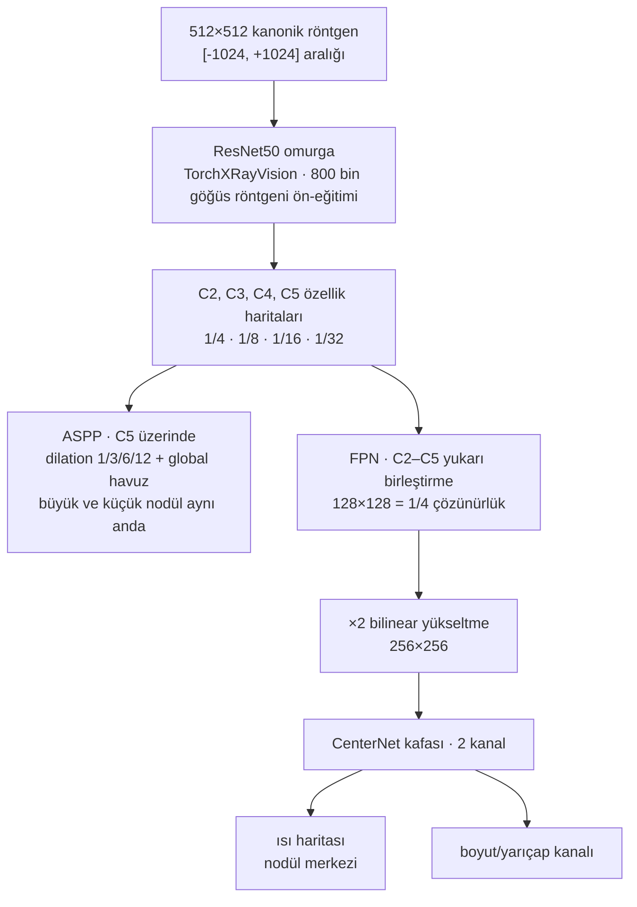
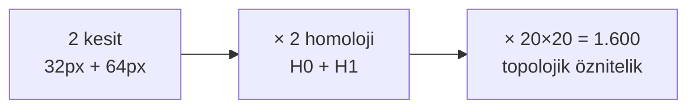
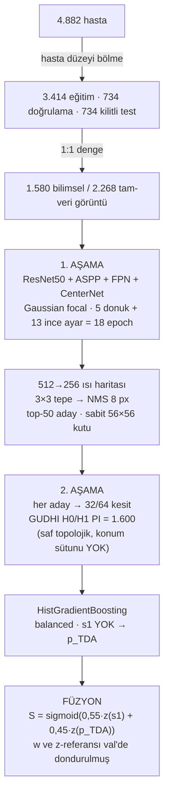
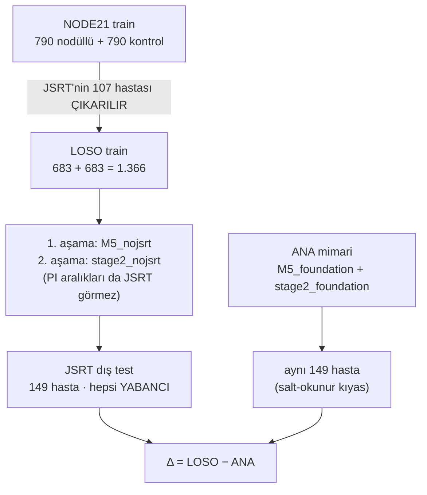

# Teknik Yöntem — NODE21 Nodül Tespiti (İki Aşamalı: Dedektör + Lokal TDA)

> Bu belge, sistemin **nasıl inşa edildiğini** adım adım anlatır: veri hazırlığı, 1. aşama
> dedektörün mimarisi ve eğitimi, 2. aşama TDA havuzunun kurulması ve iki aşamanın sızıntısız
> birleştirilmesi. Bütün sayılar kodla ve kayıtlı deney raporlarıyla doğrulanmıştır.
>
> ⚠️ **İki düzeltme:** Taslak metindeki iki ifade kodla uyuşmuyordu; doğrusu ilgili bölümlerde
> 🔧 ile işaretlendi (2. fazın kapsamı ve boyut dalının akıbeti).

---

## 1. Veri Hazırlığı ve Sızıntısız Bölünme (Temel İnşa)

Halka açık NODE21 eğitim seti **4.882 hasta** içerir (1.134 nodüllü, 3.748 temiz kontrol).

**Hasta düzeyinde bölünme.** Bölme rastgele görüntü değil, **hasta** biriminde yapılır: bir
hastanın bütün görüntüleri tek bir kümede kalır. Böylece aynı hastanın anatomisi hem eğitimde
hem testte görünüp skoru yapay olarak şişiremez. Sonuç:

| Küme | Hasta | Kullanım amacı |
| :--- | ---: | :--- |
| **Eğitim** | 3.414 | Model buradan öğrenir |
| **Doğrulama** | 734 | **Tüm tasarım kararları** burada alınır |
| **Kilitli test** | 734 | Yalnız ölçüm (ayar yapılmaz) |

**1:1 dengeleme.** Veri seti doğal olarak dengesizdir (1.134 nodüllüye karşı 3.748 kontrol).
Bu hâliyle eğitilirse model "her şeye sağlam" demeye kayar. Bu yüzden eğitimde **her nodüllü
hastaya bir temiz kontrol** eşlenir; kontroller aynı bölmeden sabit tohumla (42) seçilir:

* **Bilimsel model** (raporlanan metrikler): train bölmesinden **790 + 790 = 1.580** görüntü.
* **Tam-veri gönderim modeli**: tüm hastalardan **1.134 + 1.134 = 2.268** görüntü.

Her iki durumda da nodüllü:kontrol oranı **1:1**'dir.

---

## 2. 1. Aşama — Aday Üretici Dedektör ve İki Fazlı Eğitim

### 2.1 Mimari



Isı haritası **Gaussian Focal Loss** ile eğitilir (CenterNet standardı: pozitif bölgede
"1'e yaklaş", arka planda "0'a yaklaş", kolay örneklerin ağırlığı düşük). Boyut kanalı,
**yalnızca nodülün Gaussian-pozitif bölgesinde** (tüm görüntüde değil) regresyonla denetlenir —
aksi hâlde arka plandaki milyonlarca piksel "0 boyut" baskın çıkar.

> 🔧 **Düzeltme 1 — boyut dalının akıbeti:** Bu kanal eğitimde `R>0` değil `Y>0` maskesiyle
> denetlendi; yarıçap hedefi ise yalnız **tek merkez pikselinde** dolu olduğu için kafa
> zamanla 0'a çöktü (V6.6.7'de bulundu: tahmin ≈0,02 px). Doğru maske (`R>0`, yalnız merkez
> pikseli) ile onarıldığında çalıştı (val 0,9185 > sabit kutu 0,9131), **ama kilitli testte
> resmî skoru değiştirmedi** (0,8842 = 0,8842, V6.9f). Bu yüzden **dağıtılan sistemde boyut
> tahmini kullanılmaz; her adaya sabit 56×56 px kutu** çizilir. Yani mimaride iki kanal vardır
> ama pratikte ikinci kanal (boyut) devre dışıdır.

### 2.2 İki fazlı eğitim (unutmayı önleme)

Amaç: 800 bin röntgenin öğrettiği genel dokuyu korumak, yeni katmanları ise hızla öğretmek.

| Faz | Epoch | Ne eğitilir | Öğrenme hızı |
| :--- | ---: | :--- | :--- |
| **Faz 1 (ısınma)** | 1–5 | Omurga **tamamen donuk**; yalnız ASPP+FPN boynu ve kafalar | 1e-3 |
| **Faz 2 (ince ayar)** | 6–18 | **Yalnız omurganın üst blokları** (layer3, layer4) + boyun + kafalar | omurga 1e-4 · kafa 1e-3 |

Toplam **18 epoch**, batch 4, Cosine Annealing ile 1e-5'e kadar azalan öğrenme hızı.
**BatchNorm istatistikleri tüm eğitim boyunca donuk** (`eval` modunda): 800 bin röntgenden gelen
`running_mean/var` bozulmaz.

> 🔧 **Düzeltme 2 — "tüm ağ" değil, diferansiyel ince ayar:** Faz 2'de ağın tamamı açılmaz;
> kodda `unfreeze_top()` yalnız `layer3` ve `layer4` bloklarını açar (erken katmanlar donuk
> kalır). Buna **diferansiyel (kademeli) ince ayar** denir: üst katmanlar hedefe özgü özellikleri
> öğrenirken alt katmanlar genel doku bilgisini korur. Ayrıca omurga düşük (1e-4), kafalar
> yüksek (1e-3) hızla öğrenir.

---

## 3. 2. Aşama — TDA Veri Havuzu ve Sınıflandırıcı

### 3.1 Aday havuzu ve etiketleme

Eğitilmiş 1. aşama modeli **eğitim hastalarında** çalıştırılır; hasta başına **50 şüpheli kutu**
(top-50) alınır. Uygulamada 1.580 eğitim hastasından **74.950 aday** toplanmıştır (dağıtılan saf
1.600 modelinin eğitim havuzu; eski 1.604 bundle'ı farklı bir kontrol permütasyonuyla 74.482 aday
kullanmıştı — aynı boyut, ikisi de train-only).

Her aday, gerçek nodül kutularıyla (Kriter-1: merkez bbox içinde) karşılaştırılarak etiketlenir:

* **Pozitif (1):** kutunun merkezi bir gerçek nodülün içine düşüyor.
* **Zor-negatif / Hard-negative (0):** dedektörün yanıldığı, nodül olmayan bölge
  (damar kesiti, kaburga gölgesi, hilus artefaktı).

"Zor" negatif olması kritiktir: model rastgele arka planla değil, **kendi karıştırdığı**
yapılarla sınanır.

**Dengesizlik:** havuzun yalnızca **%1,72'si pozitiftir** (≈1:57). Nodüllü bir hastanın 50
adayından tipik olarak 1–2'si gerçektir; yani hasta içinde ≈**1:49**. Bu dengesizlik
`class_weight="balanced"` ile korunur (nadir sınıfa otomatik ağırlık) ve eğitim hastaları
1:1 seçilir.

### 3.2 Özellik çıkarımı (lokal topoloji)

Her aday merkezinden iki kesit alınır: **32×32 (çekirdek)** ve **64×64 (çevre)**. Her kesitte
**GUDHI** kütüphanesiyle **kübik kalıcı homoloji** hesaplanır:

* **H0** → parlaklık tepecikleri (bağlı bileşenler)
* **H1** → döngüler/delikler

Her diyagram, **eğitim adaylarından türetilip dondurulmuş** doğum–kalıcılık eksen aralıklarıyla
(p1–p99) ve **Gaussian yumuşatma** (σ=1,0 piksel) ile **20×20 kalıcılık imgesine** rasterize
edilir:



**Güncel temsil: 1.600 boyutlu SAF topolojik vektör.** (2 kesit × 2 homoloji × 20×20 PI.)
Daha önceki sürümlerde buna **4 uzamsal konum sütunu** ekleniyordu (`rel_x`, `rel_y`,
akciğer alanı merkezine uzaklık = "hilus vekili", akciğer maskesi sınırına uzaklık =
"plevra vekili") ⇒ 1.604. **V6.9l ablasyonu** bu 4 sütunun hasta düzeyinde katkı
sağlamadığını (±0,001 AUC; işaretler ters) ve aday düzeyinde **zarar verdiğini**
(TDA-tek AUC 0,9387 → 0,9242) gösterdi ⇒ Occam'ın usturası gereği **çıkarıldı** (V6.9m).
Ayrıntı ve kilitli test sonucu: [experiments.md](experiments.md) §V6.9.13–14.

> ⚠️ **TARİHSEL KAYIT — çıkarılan 4 uzamsal vekil (v6.1–v6.9l sürümleri).** Aşağıdaki tanımlar
> artık **kullanılmamaktadır**; V6.9l'de ölçülüp V6.9m'de kaldırılmıştır. Kayıt olarak duruyor,
> çünkü eski sürümlerin sayılarını okuyan biri bu sütunların ne olduğunu bilmelidir. Bu iki
> "mesafe" **anatomik ölçüm değil, geometrik vekildir**; gerçek hilus (ana damar kökü)
> **tespit edilmez**. Tanımlar ([`v6_1_stage2.py`](pipelines/v6_two_stage/v6_1_stage2.py)
> `_spatial()`):
>
> | Özellik | Kodda nasıl hesaplanır | Gerçekte ne |
> | :--- | :--- | :--- |
> | `rel_x`, `rel_y` | `(cx − x0)/w`, `(cy − y0)/h` — **akciğer maskesi bbox'ı** içinde normalize konum | Akciğer alanı içindeki göreli konum |
> | `hilus` | `‖(cx,cy) − bbox merkezi‖ / bbox köşegeni` | **Bbox merkezine** uzaklık (medial orta hat + orta yükseklik) — hilusun *vekilidir*, hilusun kendisi değil |
> | `plevra` | `distance_transform_edt(akciğer maskesi)[cy,cx] / 30` | **En yakın akciğer-dışı piksele** uzaklık |
>
> İki sınırlama: (i) `hilus` özelliği **hilusun üstünde/altında** ama medialde olan adayları da
> "hilusa yakın" sayar (y ekseni tam doğru değil); (ii) `plevra` sınır dönüşümü göğüs duvarı,
> diyafram **ve mediasten** sınırlarını birlikte sayar ⇒ "duvara yakın" ile "mediastene yakın" bu
> tek sayıda karışır (`rel_x` kısmen ayırır). Ayrıca **30 px** kalibre edilmiş bir mesafe değil,
> normalizasyon ölçeğidir. Maske kaynağı PSPNet'tir; "5 bölge" gerçek lob segmentasyonu değil,
> akciğer yüksekliğinin dikey dilimidir (sağ: 3, sol: 2) ve uzamsal özelliklerde **yalnızca
> birleşim** (`zone > 0`) kullanılırdı.
>
> 📊 **Neden çıkarıldı (V6.9l, yalnız val):** bu 4 konum sütununun hasta düzeyi katkısı
> **gösterilemedi** — 1600 (konum yok) vs 1604 (mevcut) vs 1606 (anatomik) kolları arasında
> füzyon AUC farkı **±0,001**, rank_metric farkı **±0,0025** ve işaretler **ters yönlü**.
> Aday düzeyinde ise konum sütunları **zarar veriyordu** (TDA-tek AUC 0,9387 → 0,9242). Gerçek
> medial/lateral kenarları kullanan anatomik kodlama da vekili geçmedi (−0,0008).
> [experiments.md](experiments.md) §V6.9.13 · kilitli test doğrulaması §V6.9.14.

> ⚠️ Kesitler **yeniden boyutlandırılmaz** ve sabit 32/64 px'tir. Sebep ölçülmüştür: interpolasyon
> (bilinear resize) H1 döngülerini siler — V5.1'de ölçek normalizasyonu TDA'yı 0,9211 → 0,8539'a
> düşürmüştü. Ayrıca değişken kesit boyutu "boyut confound'u" yaratır (E3.6: 0,994 → 0,687).

### 3.3 Sınıflandırıcı

**1.600 boyutlu** vektör **StandardScaler** ile ölçeklenir, ardından
**HistGradientBoostingClassifier** (`max_iter=200`, `learning_rate=0,08`,
`class_weight="balanced"`) eğitilir. Çıktı: adayın "gerçek nodül olma" olasılığı `p_TDA`.

> ℹ️ **Güncel sürüm (V6.9m) — saf 1.600:** dağıtılan bundle
> `checkpoints/stage2_foundation_tda_hgb_pure1600.joblib`'dir; girdisi **yalnız 1.600 saf
> topolojik** özelliktir (konum sütunu yok). Kilitli testte resmî rank_metric **0,9047**
> (1.604 sürümü: 0,9045) — eşit; buna karşılık S@0,5 **0,7642** vs 0,7904 (−2,6 puan).
> Önceki 1.604 bundle'ı `stage2_foundation_tda_hgb.joblib` olarak **silinmeden korunur**.

> ℹ️ **Aday dağılımı uyumu (V6.9i):** Bu sınıflandırıcı, 1. aşamanın **kendi aday dağılımı**
> üzerinde eğitilir. Eski bir sürüm M5 (ImageNet) dedektörünün adaylarıyla eğitilmişti; o
> uyumsuzluk kilitli testte 0,0075 rank kaybına mal oluyordu. Foundation adaylarıyla yeniden
> eğitim bunu giderdi (test: rank 0,8970 → **0,9045**, AUC 0,9645 → **0,9687**).

---

## 4. Aşırı Özgüven (Stacking) Tuzağından Kaçınarak Birleştirme

Naif yaklaşım şudur: 2. aşama modeline 1. aşamanın skorunu da özellik olarak verirsin, o da
"1. aşama ne dediyse ona güvenir". Bu **iki kat sızıntı** doğurur:

1. **Eğitimde in-sample skor:** 1. aşamanın skoru, kendi **eğitim verisinde** şişmiştir
   (model ezberlediği örneklerde aşırı özgüvenlidir). 2. aşama bu şişkin skoru "gerçek" sanıp
   ona aşırı ağırlık verir.
2. **Öğrenilen füzyon katsayısı** da bu yanlı dağılıma göre uydurulur ⇒ val'de iyi görünür,
   gerçek dağılımda çöker.

**Bizim çözümümüz (V6.7'den itibaren yapısal koruma):**

* ✅ **Bağımsız eğitim:** 2. aşamanın özellik matrisi **1. aşama skorunu içermez** —
  yalnız 1.600 saf topolojik PI. (Bundle'da `stage1_score_included = False` olarak assert edilir.)
* ✅ **Kilitli sabit ağırlık:** İki skor, **doğrulama kümesinde** belirlenen ve bir daha
  **yeniden uydurulmayan** sabit ağırlıkla birleştirilir:

```
z(s1) ve z(p_TDA): doğrulama kümesinden dondurulmuş ortalama/standart sapma ile
S = sigmoid( 0,55 · z(s1) + 0,45 · z(p_TDA) )
```

`w = 0,55` **kilitlidir**; hiçbir veri kümesinde (eğitim/doğrulama/test) yeniden öğrenilmez.
Z-normalizasyon referansı da **doğrulamadan** donar; testin kendi dağılımından istatistik
alınmaz (transductive sızıntı yok).

> 📌 **Neden sabit ağırlık?** Öğrenilen bir LR/LR-benzeri füzyon, az sayıda hastada kolayca
> aşırı uyum sağlar. Sabit, önceden doğrulanmış ağırlık; hem sızıntısız hem tekrarlanabilirdir.
> Ayrıntı: [LEAK_AUDIT.md](LEAK_AUDIT.md) §4 ve Tuzak B notu.

> ⚖️ **Ağırlık duyarlılığı (V6.9s):** `w_tda` ∈ [0,40 … 0,70] taramasında hasta AUC `w_tda` ile artar (Test 0,966 → 0,978), ama kutu ölçütleri `w_tda` ≈ 0,45–0,50'de tepe yapıp ≥ 0,60'ta düşer (Test S@0.25 %72,1 → %61,6): TDA kutu koordinatını değiştirmez, sabit aday havuzunu yeniden sıralar ve ağırlık büyüdükçe 1. aşamada alt sırada kalan sahte adaylar 1. sıraya çıkar. Kilitli `w = 0,55 / 0,45` değişmedi. Ayrıntı: `experiments.md` V6.9.18, `ablation_matrix.md` §17.12.

---

## 5. Özet akış



**Kilitli test sonucu (sızıntısız, ayarsız):** yalnız 1. aşama rank_metric **0,8842** /
AUC **0,9446** → iki aşamalı füzyon rank_metric **0,9045** / AUC **0,9687** (1.604 sürümü) ·
**0,9047** / 0,9661 ve S@0,5 0,7642 (**saf 1.600, V6.9m — dağıtılan sürüm)**.
Ayrıntı: [experiments.md](experiments.md) · [ablation_matrix.md](ablation_matrix.md) ·
[LEAK_AUDIT.md](LEAK_AUDIT.md).

---

## 6. Dış Genelleme — Bir Kaynağı Tamamen Dışarıda Bırakmak (LOSO)

Yukarıdaki bütün sayılar **kendi veri setimiz içinde** ölçülmüştür: NODE21 dört açık kaynaktan
derlenmiştir ve model bu kaynakların **hepsinden** hasta görür. "Yeni bir merkeze ne kadar
genelleniyor?" sorusunun dürüst cevabı için, bir kaynağı **eğitimden tamamen çıkarmak** gerekir.

JSRT (Japon kaynağı, 149 hasta; 107'si `train`, 23'ü `val`, 19'u `test`) bu test için seçildi:



**Sonuç.** LOSO modelinin JSRT'deki gerçek dış performansı: **Recall@K10 0,8523 · K20 0,8792 ·
K50 0,9396 · hasta AUC 0,9395 (top1) / 0,9767 (noisy-OR)**.

| Ölçüt (JSRT, 149 hasta) | LOSO | ANA | Δ |
| :--- | ---: | ---: | ---: |
| Recall@K10 | 0,8523 | 0,9396 | −0,0873 |
| Recall@K50 | 0,9396 | 0,9799 | −0,0403 |
| Hasta AUC (füzyon, top1) | 0,9395 | 0,9674 | −0,0279 |

⚠️ Bu farkın **büyük kısmı in-sample ezberdir**: 149 hastanın **107'si ana modelin eğitim
kümesindeydi**. Hiçbir modelin eğitiminde olmayan **42 JSRT hastasında** fark küçülür:
1. aşama hasta AUC **−0,0432** [−0,0809; −0,0064]. Bu fark **veri azalmasıyla açıklanamaz** —
aynı iki model JSRT-dışı doğrulama hastalarında **eşittir** (Δ **+0,0013**) ⇒ fark-farkı
**−0,0435** [−0,0813; −0,0067].

**Kullanım kuralı.** Kilitli test sayıları **`in-fold`** olarak etiketlenir (veri seti içinde
geçerli). *Kaynak-dışı genelleme* iddiasında **LOSO** sayıları kullanılır. Ayrıntı ve izolasyon
denetimi: [LEAK_AUDIT.md](LEAK_AUDIT.md) §9.7 ·
[`v6_9k_leave_jsrt_out.py`](pipelines/v6_two_stage/v6_9k_leave_jsrt_out.py).
